# 4 · The flows, one by one

**You get:** for every flow, what is on its canvas, what it does, what to click and what to change.
**You need:** nothing; read the section you are about to open.

This page is generated from the flow files by `langflow/scripts/flow_docs.py`: the card list and the wiring diagram come
from the JSON, the explanation is the note card written on the canvas itself. Edit the flows (or
`langflow/scripts/build_flows.py`) and regenerate; do not edit this page by hand.

**Exam** flows take one sealed task in and are scored outside Langflow by the frozen scorer; **chat** flows are a
conversation and score nothing. Every model card accepts any model name ([02-keys-and-models.md](02-keys-and-models.md)).

## 5 · Shared tool flows

Flows the memory assistants run as tools: memory search (paper 2), the official Pilot on pasted SysML, write to memory (gate, write, record, knowledge base), the design pipeline. Imported first; projects 3 and 4 point at them.

Folder: [`langflow/flows/5-shared-tools/`](../../langflow/flows/5-shared-tools/)

### Memory search

`tool flow (run by projects 3 and 4)` · file [`5-shared-tools/tool-memory-search.json`](../../langflow/flows/5-shared-tools/tool-memory-search.json) · 5 cards · Search the memory for parts, attributes, limits and connections related to the engineer's words: the memory library, MiniLM + FAISS seeds (cosine ≥ 0.30 plus the exact-name bonus), one hop of neighbours; returns the matching cards with values and sources.

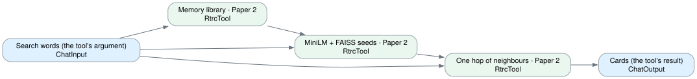

| Card | Component | What it does |
|---|---|---|
| Search words (the tool's argument) | `ChatInput` | What the engineer is asking about. |
| Memory library · Paper 2 | `RtrcTool` | The sources the search reads: MaritimeISR and every approved design (analysis/memory/approved.jsonl), as element cards from the official Pilot parse. |
| MiniLM + FAISS seeds · Paper 2 | `RtrcTool` | bench/vector_index.py (frozen): the query embedded by the pinned MiniLM, searched in a FAISS index of the cards; cosine ≥ 0.30 plus the exact-name bonus. The index is cached by content hash and rebuilt when the memory ch… |
| One hop of neighbours · Paper 2 | `RtrcTool` | bench/discover.py retrieve_existing: each seed's linked elements, then the cards the assistant receives, with values and sources. |
| Cards (the tool's result) | `ChatOutput` | Display a chat message in the Playground. |

**On the canvas:** The assistant's memory search as cards, in the order the code runs: the library, the vector seeds, the one-hop expansion. Every card calls the same function the results page and the pipeline's ① Search memory use, so the cards here are the cards there. A tool of the memory assistants (projects 3 and 4), chat and exam versions.

- The library is the memory itself: MaritimeISR plus every approved design, re-read on every call, so a newly approved design is searchable at once.
- The MiniLM + FAISS index is a derived cache keyed by the cards' content; it rebuilds itself when the memory changes (bench/vector_index.py, frozen).
- The knowledge base rtrc_memory (Qwen embeddings) is a second, separate index for Langflow's own search; the write-to-memory flow refreshes it.

### Validate SysML with the official Pilot

`tool flow (run by projects 3 and 4)` · file [`5-shared-tools/tool-validate-sysml.json`](../../langflow/flows/5-shared-tools/tool-validate-sysml.json) · 4 cards · Parse SysML v2 text the engineer pasted with the official SysML v2 Pilot: the text is saved as a file and parsed; returns PASS or FAIL with the diagnostics (line and message).

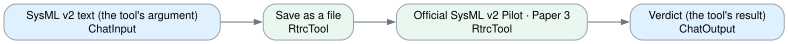

| Card | Component | What it does |
|---|---|---|
| SysML v2 text (the tool's argument) | `ChatInput` | What the engineer pasted. |
| Save as a file | `RtrcTool` | The text becomes <package>.sysml under mvp/exam-inbox/; the package name is read from the text. |
| Official SysML v2 Pilot · Paper 3 | `RtrcTool` | mvp/engine.py run_submitted_model: the same Pilot 0.62 that grades the exam; PASS or FAIL with every diagnostic. |
| Verdict (the tool's result) | `ChatOutput` | Display a chat message in the Playground. |

**On the canvas:** The official Pilot on text the engineer pastes, as two cards: the file, then the parse. The Pilot is the judge here as everywhere else; the assistant only reports what it says. A tool of every Langflow-Agent flow and of the OpenCode-with-memory assistant, chat and exam versions.

### Write to memory

`tool flow (run by projects 3 and 4)` · file [`5-shared-tools/tool-write-to-memory.json`](../../langflow/flows/5-shared-tools/tool-write-to-memory.json) · 7 cards · Write an approved design into the memory: the gate (official Pilot PASS and all four checks PASS), the write, the record on the run, and the knowledge base refreshed with the new cards. The argument is '<run id> A' or '<run id> B'. Refuses a design that did not pass or is already in memory.

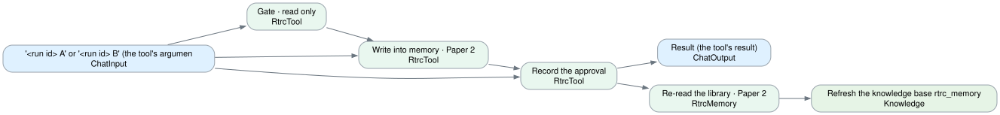

| Card | Component | What it does |
|---|---|---|
| '<run id> A' or '<run id> B' (the tool's argument) | `ChatInput` | The design the engineer approved. |
| Gate · read only | `RtrcTool` | The page's rule before anything is written: official Pilot PASS, and POWER, LINK, STORE, TRACE all PASS; refuses a design already in memory. |
| Write into memory · Paper 2 | `RtrcTool` | Appends the design to analysis/memory/approved.jsonl and keeps its SysML file; the same gate refuses when a check failed. |
| Record the approval | `RtrcTool` | The decision, grades and times on the run's record (page 2.3); only when the write happened. |
| Result (the tool's result) | `ChatOutput` | Display a chat message in the Playground. |
| Re-read the library · Paper 2 | `RtrcMemory` | MaritimeISR plus every approved design, now including the new one, as cards from the official parse. |
| Refresh the knowledge base rtrc_memory | `Knowledge` | Embeds only the new cards with Qwen (qwen3.7-text-embedding); rows already there are skipped. Langflow's search sees the new design without running F0 by hand. |

**On the canvas:** The approval gate of AGENTS.md as cards. The Langflow-Agent chat assistant pauses for the person before running this flow (the Actions row of its card); then: the gate (read only) → the write through the page's gate → the record → the memory re-read and the knowledge base refreshed with the new cards. The exam versions do not have this tool.

- Nothing is written when the gate is closed: a failed check, a failed parse, or an unsourced number.
- The MiniLM + FAISS index and list/read/search tools see the new design at once (they re-read the memory); this flow also refreshes Langflow's own knowledge base, so the knowledge-base fill flow no longer has to be run by hand after an approval.

### Design pipeline

`tool flow (run by projects 3 and 4)` · file [`5-shared-tools/tool-design-pipeline.json`](../../langflow/flows/5-shared-tools/tool-design-pipeline.json) · 17 cards · Run the verified RTRC design pipeline on a confirmed brief: memory search, numbered requirements, designs A and B written by OpenCode in a sandbox with the official SysML v2 Pilot, the Pilot's verdict, alignment with the memory, the power / upload / storage / trace checks, trade-offs when a check fails, diagram and Cameo export. Returns the review text with the run id. Takes 2 to 10 minutes; the results page (port 8770) may stay open.

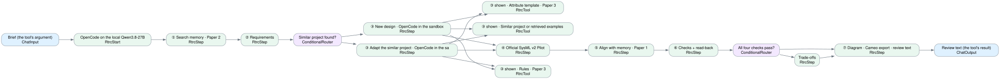

| Card | Component | What it does |
|---|---|---|
| Brief (the tool's argument) | `ChatInput` | The unfolded assistant passes the confirmed brief here. |
| ⑥ Checks + read-back | `RtrcStep` | Power, upload, storage and trace from numbers in the official parse. Starts with pass or fail. |
| OpenCode on the local Qwen3.8-27B | `RtrcStart` | Preset: OpenCode in the sandbox, qwen3.8-27b (Ollama). Every model call stays on this machine. |
| All four checks pass? | `ConditionalRouter` | True: to review. False: trade-offs first. |
| ① Search memory · Paper 2 | `RtrcStep` | Cards from the official parse of MaritimeISR and approved designs; MiniLM + FAISS; seeds plus one hop. |
| Trade-offs | `RtrcStep` | Three proposals from catalog parts only; code recomputes each one; a stated limit never changes. |
| ② Requirements | `RtrcStep` | Numbered requirements; every number must come from the brief. The message starts with reuse or new. |
| ⑦ Diagram · Cameo export · review text | `RtrcStep` | The review the assistant hands back to the engineer. Saves the run for page 2.3. |
| Similar project found? | `ConditionalRouter` | True (reuse): adapt the similar project. False (new): write a new design. |
| Review text (the tool's result) | `ChatOutput` | Returned to the assistant; the person decides in the chat (write to memory pauses for approval). |
| ③ New design · OpenCode in the sandbox | `RtrcStep` | Rules + template + retrieved examples + brief; A literal, B another arrangement; written with ./validate in hand. |
| ③ Adapt the similar project · OpenCode in the sandbox | `RtrcStep` | Design A edits the similar project's model; design B is written new. OpenCode has ./validate (the official Pilot) in hand and edits until it parses. |
| ④ Official SysML v2 Pilot | `RtrcStep` | The Pilot is the judge. Every parse attempt is listed. |
| ③ shown · Rules · Paper 3 | `RtrcTool` | The SysML v2 rules OpenCode wrote the designs under (bench/discover.py DESIGN_RULES). Read only. |
| ③ shown · Attribute template · Paper 3 | `RtrcTool` | The attribute contract: one attribute per requirement, names verbatim, numbers from the brief. Read only. |
| ③ shown · Similar project or retrieved examples · Paper 2 | `RtrcTool` | What came from the memory: the similar project's model to adapt, or the retrieved element cards. Read only. |
| ⑤ Align with memory · Paper 1 | `RtrcStep` | The model proposes pairs; code checks both names and writes an alias / allocate package; the Pilot parses it with both sources. |

**On the canvas:** The design pipeline the **Langflow Agent with memory chat · qwen3.8-max** and its local twin run when the engineer has confirmed a brief: the design agent flow without the person's step. It ends at the review text; the decision is made in the chat (write to memory pauses for the person's approval, record decision saves it).

- Same nodes and the same shell service as the agent flow, so a run here and a run on the results page give the same retrieval, prompts, Pilot results and checks. The record appears on page 2.3.
- Designs are written by OpenCode in the bubblewrap sandbox on the local Qwen3.8-27B, with `./validate` in hand (decision 032): the Pilot's errors come back as a tool result and the file is edited.
- The results page (8770) may stay open during a run: the sandbox cannot reach it. Edit this flow and the assistant runs the edited version.

## 1 · Direct model, approaches P0 to P3

The exam's fixed paths, one flow per approach: P0 writes once; P1 repairs from the official Pilot's complete error list; P2 outlines first; P3 retrieves examples (paper 2) before the outline. The model has no tools. Exam: a sealed task id in, scored against its key. Chat: a conversation; your words reach the model as written, the approach's steps run around them, and a model in the reply is parsed by the official Pilot; nothing scored.

Folder: [`langflow/flows/1-direct-model/`](../../langflow/flows/1-direct-model/)

### Direct model exam · P0 one-shot

`exam` · file [`1-direct-model/direct-exam-p0.json`](../../langflow/flows/1-direct-model/direct-exam-p0.json) · 9 cards · One exam cell of Direct model · P0 one-shot: a sealed task in, the verdict out; or replay a graded cell.

| Card | Component | What it does |
|---|---|---|
| Exam cell · Direct model · P0 one-shot · qwen3.8-flash | `RtrcExamCell` | P0 one-shot: the model writes once; a failed parse is not repaired. Type a sealed task id and run, or switch the mode to replay a graded cell. Time and tokens are recorded. The answer key is used only by the scorer. |
| Verdict and record | `ChatOutput` | Display a chat message in the Playground. |
| Issue task | `RtrcExamStep` | One step of the exam cell, from the cell record: its state, the official errors, the verdict or the agent's tool calls. |
| Write answer · Paper 3 | `RtrcExamStep` | One step of the exam cell, from the cell record: its state, the official errors, the verdict or the agent's tool calls. |
| Official syntax | `RtrcExamStep` | One step of the exam cell, from the cell record: its state, the official errors, the verdict or the agent's tool calls. |
| Read values | `RtrcExamStep` | One step of the exam cell, from the cell record: its state, the official errors, the verdict or the agent's tool calls. |
| Check against key | `RtrcExamStep` | One step of the exam cell, from the cell record: its state, the official errors, the verdict or the agent's tool calls. |
| Approval gate | `RtrcExamStep` | One step of the exam cell, from the cell record: its state, the official errors, the verdict or the agent's tool calls. |
| Archive | `RtrcExamStep` | One step of the exam cell, from the cell record: its state, the official errors, the verdict or the agent's tool calls. |

**On the canvas:** P0 one-shot: the model writes once; a failed parse is not repaired.

- One task: type its id (GEN-01 … RT-05) in the cell node and run; the steps light up with the record and the verdict against the sealed key (missing items only, never the key). Such a run is saved under analysis/langflow-console/ and is not added to the frozen score.
- The whole exam: `python3 bench/langflow_exam.py --flow "Direct model exam · P0 one-shot"` runs the 27 tasks three times through this flow and saves a rerun batch next to the frozen one; the frozen matrix of results page 1.3 does not change.
- Replay: set the mode to *Replay a graded cell* and a cell id such as `flash:1:GEN-03:P1` or `opencode:1:MOD-05:P-CODE`.

### Direct model exam · P1 repair from errors

`exam` · file [`1-direct-model/direct-exam-p1.json`](../../langflow/flows/1-direct-model/direct-exam-p1.json) · 10 cards · One exam cell of Direct model · P1 repair from errors: a sealed task in, the verdict out; or replay a graded cell.

| Card | Component | What it does |
|---|---|---|
| Exam cell · Direct model · P1 repair from errors · qwen3.8-flash | `RtrcExamCell` | P1: a failed parse sends the official Pilot's complete error list back in the same conversation, up to 20 times (paper 3's correction, by the tool). Type a sealed task id and run, or switch the mode to replay a graded ce… |
| Archive | `RtrcExamStep` | One step of the exam cell, from the cell record: its state, the official errors, the verdict or the agent's tool calls. |
| Issue task | `RtrcExamStep` | One step of the exam cell, from the cell record: its state, the official errors, the verdict or the agent's tool calls. |
| Verdict and record | `ChatOutput` | Display a chat message in the Playground. |
| Write answer · Paper 3 | `RtrcExamStep` | One step of the exam cell, from the cell record: its state, the official errors, the verdict or the agent's tool calls. |
| Official syntax | `RtrcExamStep` | One step of the exam cell, from the cell record: its state, the official errors, the verdict or the agent's tool calls. |
| Repair from errors · Paper 3 loop | `RtrcExamStep` | One step of the exam cell, from the cell record: its state, the official errors, the verdict or the agent's tool calls. |
| Read values | `RtrcExamStep` | One step of the exam cell, from the cell record: its state, the official errors, the verdict or the agent's tool calls. |
| Check against key | `RtrcExamStep` | One step of the exam cell, from the cell record: its state, the official errors, the verdict or the agent's tool calls. |
| Approval gate | `RtrcExamStep` | One step of the exam cell, from the cell record: its state, the official errors, the verdict or the agent's tool calls. |

**On the canvas:** P1: a failed parse sends the official Pilot's complete error list back in the same conversation, up to 20 times (paper 3's correction, by the tool).

- One task: type its id (GEN-01 … RT-05) in the cell node and run; the steps light up with the record and the verdict against the sealed key (missing items only, never the key). Such a run is saved under analysis/langflow-console/ and is not added to the frozen score.
- The whole exam: `python3 bench/langflow_exam.py --flow "Direct model exam · P1 repair from errors"` runs the 27 tasks three times through this flow and saves a rerun batch next to the frozen one; the frozen matrix of results page 1.3 does not change.
- Replay: set the mode to *Replay a graded cell* and a cell id such as `flash:1:GEN-03:P1` or `opencode:1:MOD-05:P-CODE`.

### Direct model exam · P2 outline first

`exam` · file [`1-direct-model/direct-exam-p2.json`](../../langflow/flows/1-direct-model/direct-exam-p2.json) · 11 cards · One exam cell of Direct model · P2 outline first: a sealed task in, the verdict out; or replay a graded cell.

| Card | Component | What it does |
|---|---|---|
| Exam cell · Direct model · P2 outline first · qwen3.8-flash | `RtrcExamCell` | P2: an outline of parts, ports and connections first (no SysML yet), then the answer, then repairs as in P1. Type a sealed task id and run, or switch the mode to replay a graded cell. Time and tokens are recorded. The an… |
| Approval gate | `RtrcExamStep` | One step of the exam cell, from the cell record: its state, the official errors, the verdict or the agent's tool calls. |
| Issue task | `RtrcExamStep` | One step of the exam cell, from the cell record: its state, the official errors, the verdict or the agent's tool calls. |
| Archive | `RtrcExamStep` | One step of the exam cell, from the cell record: its state, the official errors, the verdict or the agent's tool calls. |
| Outline · Paper 3 | `RtrcExamStep` | One step of the exam cell, from the cell record: its state, the official errors, the verdict or the agent's tool calls. |
| Verdict and record | `ChatOutput` | Display a chat message in the Playground. |
| Write answer · Paper 3 | `RtrcExamStep` | One step of the exam cell, from the cell record: its state, the official errors, the verdict or the agent's tool calls. |
| Official syntax | `RtrcExamStep` | One step of the exam cell, from the cell record: its state, the official errors, the verdict or the agent's tool calls. |
| Repair from errors · Paper 3 loop | `RtrcExamStep` | One step of the exam cell, from the cell record: its state, the official errors, the verdict or the agent's tool calls. |
| Read values | `RtrcExamStep` | One step of the exam cell, from the cell record: its state, the official errors, the verdict or the agent's tool calls. |
| Check against key | `RtrcExamStep` | One step of the exam cell, from the cell record: its state, the official errors, the verdict or the agent's tool calls. |

**On the canvas:** P2: an outline of parts, ports and connections first (no SysML yet), then the answer, then repairs as in P1.

- One task: type its id (GEN-01 … RT-05) in the cell node and run; the steps light up with the record and the verdict against the sealed key (missing items only, never the key). Such a run is saved under analysis/langflow-console/ and is not added to the frozen score.
- The whole exam: `python3 bench/langflow_exam.py --flow "Direct model exam · P2 outline first"` runs the 27 tasks three times through this flow and saves a rerun batch next to the frozen one; the frozen matrix of results page 1.3 does not change.
- Replay: set the mode to *Replay a graded cell* and a cell id such as `flash:1:GEN-03:P1` or `opencode:1:MOD-05:P-CODE`.

### Direct model exam · P3 retrieval then outline

`exam` · file [`1-direct-model/direct-exam-p3.json`](../../langflow/flows/1-direct-model/direct-exam-p3.json) · 12 cards · One exam cell of Direct model · P3 retrieval then outline: a sealed task in, the verdict out; or replay a graded cell.

| Card | Component | What it does |
|---|---|---|
| Exam cell · Direct model · P3 retrieval then outline · qwen3.8-flash | `RtrcExamCell` | P3: MiniLM + FAISS retrieval over the official-examples library (paper 2) into the outline prompt, then the answer, then repairs as in P1. Type a sealed task id and run, or switch the mode to replay a graded cell. Time a… |
| Check against key | `RtrcExamStep` | One step of the exam cell, from the cell record: its state, the official errors, the verdict or the agent's tool calls. |
| Issue task | `RtrcExamStep` | One step of the exam cell, from the cell record: its state, the official errors, the verdict or the agent's tool calls. |
| Approval gate | `RtrcExamStep` | One step of the exam cell, from the cell record: its state, the official errors, the verdict or the agent's tool calls. |
| Retrieve notes · Paper 2 | `RtrcExamStep` | One step of the exam cell, from the cell record: its state, the official errors, the verdict or the agent's tool calls. |
| Archive | `RtrcExamStep` | One step of the exam cell, from the cell record: its state, the official errors, the verdict or the agent's tool calls. |
| Outline · Paper 3 | `RtrcExamStep` | One step of the exam cell, from the cell record: its state, the official errors, the verdict or the agent's tool calls. |
| Verdict and record | `ChatOutput` | Display a chat message in the Playground. |
| Write answer · Paper 3 | `RtrcExamStep` | One step of the exam cell, from the cell record: its state, the official errors, the verdict or the agent's tool calls. |
| Official syntax | `RtrcExamStep` | One step of the exam cell, from the cell record: its state, the official errors, the verdict or the agent's tool calls. |
| Repair from errors · Paper 3 loop | `RtrcExamStep` | One step of the exam cell, from the cell record: its state, the official errors, the verdict or the agent's tool calls. |
| Read values | `RtrcExamStep` | One step of the exam cell, from the cell record: its state, the official errors, the verdict or the agent's tool calls. |

**On the canvas:** P3: MiniLM + FAISS retrieval over the official-examples library (paper 2) into the outline prompt, then the answer, then repairs as in P1.

- One task: type its id (GEN-01 … RT-05) in the cell node and run; the steps light up with the record and the verdict against the sealed key (missing items only, never the key). Such a run is saved under analysis/langflow-console/ and is not added to the frozen score.
- The whole exam: `python3 bench/langflow_exam.py --flow "Direct model exam · P3 retrieval then outline"` runs the 27 tasks three times through this flow and saves a rerun batch next to the frozen one; the frozen matrix of results page 1.3 does not change.
- Replay: set the mode to *Replay a graded cell* and a cell id such as `flash:1:GEN-03:P1` or `opencode:1:MOD-05:P-CODE`.

### Direct model chat · P0 one-shot

`chat` · file [`1-direct-model/direct-chat-p0.json`](../../langflow/flows/1-direct-model/direct-chat-p0.json) · 3 cards · Direct model · P0 one-shot in a conversation: your words as written, a reply, the official Pilot on a model in it, nothing scored.

| Card | Component | What it does |
|---|---|---|
| Person | `ChatInput` | Write as you would to a colleague. Earlier messages of this session stay in the conversation. |
| Direct model · P0 one-shot · qwen3.8-flash | `RtrcChat` | Your message, as written, plus the last 30 of this session: one answer; a model in it is parsed once and not repaired. The system prompt lets it talk; only a request for a model gets a model. |
| Reply (not scored) | `ChatOutput` | Display a chat message in the Playground. |

**On the canvas:** The chat version of **Direct model exam · P0 one-shot**: the same candidate talking to a person. Your words reach it as written, and the conversation continues across messages, so "change the last one" has something to change. Nothing is scored; the official Pilot parses a reply only when it holds a fenced sysml block.

- What the approach adds happens around your message, not instead of it: P3 retrieves with your own words (no query rewrite), P2 and P3 outline only when you ask for a model, P1 to P3 repair from the Pilot's complete error list, P0 does not.
- Each turn is saved under analysis/langflow-console/ as a chat run; it never enters the frozen matrix. The exam version next to this flow still sits the sealed tasks through the frozen solver.

### Direct model chat · P1 repair from errors

`chat` · file [`1-direct-model/direct-chat-p1.json`](../../langflow/flows/1-direct-model/direct-chat-p1.json) · 3 cards · Direct model · P1 repair from errors in a conversation: your words as written, a reply, the official Pilot on a model in it, nothing scored.

| Card | Component | What it does |
|---|---|---|
| Person | `ChatInput` | Write as you would to a colleague. Earlier messages of this session stay in the conversation. |
| Direct model · P1 repair from errors · qwen3.8-flash | `RtrcChat` | Your message, as written, plus the last 30 of this session: the answer; a model in it is parsed, and the Pilot's complete error list goes back into this conversation until it passes. The system prompt lets it talk; only … |
| Reply (not scored) | `ChatOutput` | Display a chat message in the Playground. |

**On the canvas:** The chat version of **Direct model exam · P1 repair from errors**: the same candidate talking to a person. Your words reach it as written, and the conversation continues across messages, so "change the last one" has something to change. Nothing is scored; the official Pilot parses a reply only when it holds a fenced sysml block.

- What the approach adds happens around your message, not instead of it: P3 retrieves with your own words (no query rewrite), P2 and P3 outline only when you ask for a model, P1 to P3 repair from the Pilot's complete error list, P0 does not.
- Each turn is saved under analysis/langflow-console/ as a chat run; it never enters the frozen matrix. The exam version next to this flow still sits the sealed tasks through the frozen solver.

### Direct model chat · P2 outline first

`chat` · file [`1-direct-model/direct-chat-p2.json`](../../langflow/flows/1-direct-model/direct-chat-p2.json) · 3 cards · Direct model · P2 outline first in a conversation: your words as written, a reply, the official Pilot on a model in it, nothing scored.

| Card | Component | What it does |
|---|---|---|
| Person | `ChatInput` | Write as you would to a colleague. Earlier messages of this session stay in the conversation. |
| Direct model · P2 outline first · qwen3.8-flash | `RtrcChat` | Your message, as written, plus the last 30 of this session: an outline first when the message asks for a model, then the answer, then the repair loop. The system prompt lets it talk; only a request for a model gets a mod… |
| Reply (not scored) | `ChatOutput` | Display a chat message in the Playground. |

**On the canvas:** The chat version of **Direct model exam · P2 outline first**: the same candidate talking to a person. Your words reach it as written, and the conversation continues across messages, so "change the last one" has something to change. Nothing is scored; the official Pilot parses a reply only when it holds a fenced sysml block.

- What the approach adds happens around your message, not instead of it: P3 retrieves with your own words (no query rewrite), P2 and P3 outline only when you ask for a model, P1 to P3 repair from the Pilot's complete error list, P0 does not.
- Each turn is saved under analysis/langflow-console/ as a chat run; it never enters the frozen matrix. The exam version next to this flow still sits the sealed tasks through the frozen solver.

### Direct model chat · P3 retrieval then outline

`chat` · file [`1-direct-model/direct-chat-p3.json`](../../langflow/flows/1-direct-model/direct-chat-p3.json) · 3 cards · Direct model · P3 retrieval then outline in a conversation: your words as written, a reply, the official Pilot on a model in it, nothing scored.

| Card | Component | What it does |
|---|---|---|
| Person | `ChatInput` | Write as you would to a colleague. Earlier messages of this session stay in the conversation. |
| Direct model · P3 retrieval then outline · qwen3.8-flash | `RtrcChat` | Your message, as written, plus the last 30 of this session: retrieval from the official examples with your own words, then the outline, the answer and the repair loop. The system prompt lets it talk; only a request for a… |
| Reply (not scored) | `ChatOutput` | Display a chat message in the Playground. |

**On the canvas:** The chat version of **Direct model exam · P3 retrieval then outline**: the same candidate talking to a person. Your words reach it as written, and the conversation continues across messages, so "change the last one" has something to change. Nothing is scored; the official Pilot parses a reply only when it holds a fenced sysml block.

- What the approach adds happens around your message, not instead of it: P3 retrieves with your own words (no query rewrite), P2 and P3 outline only when you ask for a model, P1 to P3 repair from the Pilot's complete error list, P0 does not.
- Each turn is saved under analysis/langflow-console/ as a chat run; it never enters the frozen matrix. The exam version next to this flow still sits the sealed tasks through the frozen solver.

## 2 · Coding agents without memory: OpenCode, Claude Code, Langflow Agent

Agents that choose their own steps but have no memory tools and no design pipeline. OpenCode and Claude Code run in the bubblewrap sandbox with the task, AGENTS.md and ./validate (the official Pilot). The Langflow Agent has the official Pilot as its only tool. Exam: a sealed task in, scored, time and tokens recorded. Chat: a conversation that continues; the coding agents keep one sandbox and one session per chat.

Folder: [`langflow/flows/2-coding-agents/`](../../langflow/flows/2-coding-agents/)

### OpenCode in the sandbox exam

`exam` · file [`2-coding-agents/sandbox-exam-opencode.json`](../../langflow/flows/2-coding-agents/sandbox-exam-opencode.json) · 8 cards · One exam cell of OpenCode in the sandbox: a sealed task in, the verdict out; or replay a graded cell.

| Card | Component | What it does |
|---|---|---|
| Exam cell · OpenCode in the sandbox · qwen3.8-flash | `RtrcExamCell` | OpenCode in the bubblewrap sandbox with the task, AGENTS.md and ./validate; it repairs inside its own session; the grader parses the final answer once. Type a sealed task id and run, or switch the mode to replay a graded… |
| Issue task | `RtrcExamStep` | One step of the exam cell, from the cell record: its state, the official errors, the verdict or the agent's tool calls. |
| Write answer · Paper 3 | `RtrcExamStep` | One step of the exam cell, from the cell record: its state, the official errors, the verdict or the agent's tool calls. |
| Tool calls (agents) | `RtrcExamStep` | One step of the exam cell, from the cell record: its state, the official errors, the verdict or the agent's tool calls. |
| Official syntax | `RtrcExamStep` | One step of the exam cell, from the cell record: its state, the official errors, the verdict or the agent's tool calls. |
| Check against key | `RtrcExamStep` | One step of the exam cell, from the cell record: its state, the official errors, the verdict or the agent's tool calls. |
| Archive | `RtrcExamStep` | One step of the exam cell, from the cell record: its state, the official errors, the verdict or the agent's tool calls. |
| Verdict and record | `ChatOutput` | Display a chat message in the Playground. |

**On the canvas:** OpenCode in the bubblewrap sandbox with the task, AGENTS.md and ./validate; it repairs inside its own session; the grader parses the final answer once.

- One task: type its id (GEN-01 … RT-05) in the cell node and run; the steps light up with the record and the verdict against the sealed key (missing items only, never the key). Such a run is saved under analysis/langflow-console/ and is not added to the frozen score.
- The whole exam: `python3 bench/langflow_exam.py --flow "OpenCode in the sandbox exam"` runs the 27 tasks three times through this flow and saves a rerun batch next to the frozen one; the frozen matrix of results page 1.3 does not change.
- Replay: set the mode to *Replay a graded cell* and a cell id such as `flash:1:GEN-03:P1` or `opencode:1:MOD-05:P-CODE`.
- The results page (8770) may stay open during a live run: the sandbox has its own network and cannot reach the page's answer keys.

### Claude Code in the sandbox exam

`exam` · file [`2-coding-agents/sandbox-exam-claude-code.json`](../../langflow/flows/2-coding-agents/sandbox-exam-claude-code.json) · 8 cards · One exam cell of Claude Code in the sandbox: a sealed task in, the verdict out; or replay a graded cell.

| Card | Component | What it does |
|---|---|---|
| Exam cell · Claude Code in the sandbox · qwen3.8-flash | `RtrcExamCell` | Claude Code in the same sandbox with the same files and tools as OpenCode (cloud Qwen; the local model is not routed to it). Type a sealed task id and run, or switch the mode to replay a graded cell. Time and tokens are … |
| Issue task | `RtrcExamStep` | One step of the exam cell, from the cell record: its state, the official errors, the verdict or the agent's tool calls. |
| Write answer · Paper 3 | `RtrcExamStep` | One step of the exam cell, from the cell record: its state, the official errors, the verdict or the agent's tool calls. |
| Tool calls (agents) | `RtrcExamStep` | One step of the exam cell, from the cell record: its state, the official errors, the verdict or the agent's tool calls. |
| Official syntax | `RtrcExamStep` | One step of the exam cell, from the cell record: its state, the official errors, the verdict or the agent's tool calls. |
| Check against key | `RtrcExamStep` | One step of the exam cell, from the cell record: its state, the official errors, the verdict or the agent's tool calls. |
| Archive | `RtrcExamStep` | One step of the exam cell, from the cell record: its state, the official errors, the verdict or the agent's tool calls. |
| Verdict and record | `ChatOutput` | Display a chat message in the Playground. |

**On the canvas:** Claude Code in the same sandbox with the same files and tools as OpenCode (cloud Qwen; the local model is not routed to it).

- One task: type its id (GEN-01 … RT-05) in the cell node and run; the steps light up with the record and the verdict against the sealed key (missing items only, never the key). Such a run is saved under analysis/langflow-console/ and is not added to the frozen score.
- The whole exam: `python3 bench/langflow_exam.py --flow "Claude Code in the sandbox exam"` runs the 27 tasks three times through this flow and saves a rerun batch next to the frozen one; the frozen matrix of results page 1.3 does not change.
- Replay: set the mode to *Replay a graded cell* and a cell id such as `flash:1:GEN-03:P1` or `opencode:1:MOD-05:P-CODE`.
- The results page (8770) may stay open during a live run: the sandbox has its own network and cannot reach the page's answer keys.

### Langflow Agent, Pilot only exam

`exam` · file [`2-coding-agents/langflow-agent-pilot-exam.json`](../../langflow/flows/2-coding-agents/langflow-agent-pilot-exam.json) · 4 cards · Langflow's Agent on one exam task: the exam prompt, qwen3.8-flash, the official Pilot as its only tool.

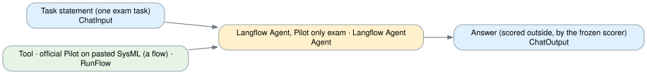

| Card | Component | What it does |
|---|---|---|
| Task statement (one exam task) | `ChatInput` | The task text as the exam gives it; bench/langflow_exam.py sends the 27 sealed tasks here, three times each. |
| Tool · official Pilot on pasted SysML (a flow) · Paper 3 | `RunFlow` | Runs the flow "Validate SysML with the official Pilot": the pasted text saved as a file → the official SysML v2 Pilot → PASS or FAIL with the diagnostics. |
| Langflow Agent, Pilot only exam · Langflow Agent · qwen3.8-flash | `Agent` | Langflow's own Agent component: the model decides which card to call and when; the cards decide nothing by themselves. Model: Qwen's cloud endpoint. Token usage is stored on each answer (time and money per task). |
| Answer (scored outside, by the frozen scorer) | `ChatOutput` |  |

**On the canvas:** Langflow's Agent sitting the 27-task exam without memory (decision 035, project 2): the exam prompt, qwen3.8-flash, and one tool, **Validate SysML with the official Pilot** (the official Pilot). It is the Langflow counterpart of the sandboxed coding agents, which have files and ./validate; it has the Pilot and nothing else.

- Run the whole exam with `python3 bench/langflow_exam.py --flow "Langflow Agent, Pilot only exam"`: 27 tasks × 3 repeats, a fresh session per task, scored by the frozen scorer; time and tokens recorded per task.
- One task by hand: paste its statement in the Playground; nothing is scored there.

### OpenCode in the sandbox chat

`chat` · file [`2-coding-agents/sandbox-chat-opencode.json`](../../langflow/flows/2-coding-agents/sandbox-chat-opencode.json) · 3 cards · OpenCode in the sandbox in a conversation: your words as written, a reply, the official Pilot on a model in it, nothing scored.

| Card | Component | What it does |
|---|---|---|
| Person | `ChatInput` | Write as you would to a colleague. Earlier messages of this session stay in the conversation. |
| OpenCode in the sandbox · qwen3.8-flash | `RtrcChat` | The agent in a sandbox kept for this session, with ./validate and rules written for a conversation; its own session continues across messages. |
| Reply (not scored) | `ChatOutput` | Display a chat message in the Playground. |

**On the canvas:** The chat version of **OpenCode in the sandbox exam**: the same candidate talking to a person. Your words reach it as written, and the conversation continues across messages, so "change the last one" has something to change. Nothing is scored; the official Pilot parses a reply only when it holds a fenced sysml block.

- The agent has files and ./validate (the official Pilot) and nothing else; it writes a .sysml file only when you ask for a model. It runs while the results page is up: a conversation is not scored, so the page's answer keys cannot enter a score.
- Each turn is saved under analysis/langflow-console/ as a chat run; it never enters the frozen matrix. The exam version next to this flow still sits the sealed tasks through the frozen solver.

### Claude Code in the sandbox chat

`chat` · file [`2-coding-agents/sandbox-chat-claude-code.json`](../../langflow/flows/2-coding-agents/sandbox-chat-claude-code.json) · 3 cards · Claude Code in the sandbox in a conversation: your words as written, a reply, the official Pilot on a model in it, nothing scored.

| Card | Component | What it does |
|---|---|---|
| Person | `ChatInput` | Write as you would to a colleague. Earlier messages of this session stay in the conversation. |
| Claude Code in the sandbox · qwen3.8-flash | `RtrcChat` | The agent in a sandbox kept for this session, with ./validate and rules written for a conversation; its own session continues across messages. |
| Reply (not scored) | `ChatOutput` | Display a chat message in the Playground. |

**On the canvas:** The chat version of **Claude Code in the sandbox exam**: the same candidate talking to a person. Your words reach it as written, and the conversation continues across messages, so "change the last one" has something to change. Nothing is scored; the official Pilot parses a reply only when it holds a fenced sysml block.

- The agent has files and ./validate (the official Pilot) and nothing else; it writes a .sysml file only when you ask for a model. It runs while the results page is up: a conversation is not scored, so the page's answer keys cannot enter a score.
- Each turn is saved under analysis/langflow-console/ as a chat run; it never enters the frozen matrix. The exam version next to this flow still sits the sealed tasks through the frozen solver.

### Langflow Agent, Pilot only chat

`chat` · file [`2-coding-agents/langflow-agent-pilot-chat.json`](../../langflow/flows/2-coding-agents/langflow-agent-pilot-chat.json) · 4 cards · Langflow's Agent with the official Pilot as its only tool, qwen3.8-flash; no memory, no design pipeline.

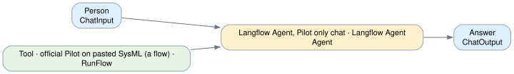

| Card | Component | What it does |
|---|---|---|
| Person | `ChatInput` | Ask for SysML v2 text; the only tool is the official Pilot. |
| Tool · official Pilot on pasted SysML (a flow) · Paper 3 | `RunFlow` | Runs the flow "Validate SysML with the official Pilot": the pasted text saved as a file → the official SysML v2 Pilot → PASS or FAIL with the diagnostics. |
| Langflow Agent, Pilot only chat · Langflow Agent · qwen3.8-flash | `Agent` | Langflow's own Agent component: the model decides which card to call and when; the cards decide nothing by themselves. Model: Qwen's cloud endpoint. |
| Answer | `ChatOutput` |  |

**On the canvas:** The chat version of the Pilot-only Langflow Agent (project 2): ask it for SysML v2 text; its one tool is **Validate SysML with the official Pilot**, the official Pilot. It has no memory of projects and no design pipeline. Its exam version sits next to it.

## 3 · OpenCode with memory

OpenCode as the conversational harness over the RTRC tools (memory search, read a project, the design pipeline, the official Pilot, the memory gate, decisions, Cameo export). Chat: the design assistant. Exam: a fresh session per task, answer only, memory search and the Pilot as the only tools, qwen3.8-flash.

Folder: [`langflow/flows/3-opencode-with-memory/`](../../langflow/flows/3-opencode-with-memory/)

### OpenCode with memory exam

`exam` · file [`3-opencode-with-memory/opencode-memory-exam.json`](../../langflow/flows/3-opencode-with-memory/opencode-memory-exam.json) · 3 cards · The OpenCode-with-memory assistant on one exam task: answer only, memory search and the official Pilot as tools.

| Card | Component | What it does |
|---|---|---|
| Task statement (one exam task) | `ChatInput` | The task text as the exam gives it; bench/langflow_exam.py sends the 27 sealed tasks here, three times each. |
| OpenCode with memory · exam · qwen3.8-flash | `RtrcOpenCodeAssistant` | A fresh OpenCode session per task on the exam workspace (~/.rtrc-assistant-exam): the exam prompt with the frozen SysML rules, and two MCP tools, search_memory and validate_sysml_text. No design run, no write to memory. … |
| Answer (scored outside, by the frozen scorer) | `ChatOutput` | Display a chat message in the Playground. |

**On the canvas:** The OpenCode-with-memory assistant sitting the 27-task exam (decision 035): the same harness as the chat version, on qwen3.8-flash (the model of the frozen exam), with the exam prompt (tools/assistant/rtrc-assistant-exam.md plus the frozen rules of agents/solve.py) and two tools only: memory search (paper 2 retrieval over MaritimeISR and the approved designs) and the official Pilot. Each message is one task and starts a fresh OpenCode session, so nothing carries over.

- Run the whole exam with `python3 bench/langflow_exam.py --flow "OpenCode with memory exam"`: 27 tasks × 3 repeats, scored by the frozen scorer, a new column on results page 1.3 with time and tokens. The answer keys never enter the prompt.
- One task by hand: paste its statement in the Playground; nothing is scored there.

### OpenCode with memory chat

`chat` · file [`3-opencode-with-memory/opencode-memory-chat.json`](../../langflow/flows/3-opencode-with-memory/opencode-memory-chat.json) · 3 cards · Ask, discuss, confirm requirements, run the verified design pipeline, decide. OpenCode on the local Qwen3.8-27B over the RTRC MCP tools.

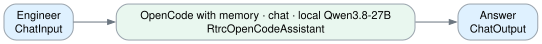

| Card | Component | What it does |
|---|---|---|
| Engineer | `ChatInput` | Ask, describe a need, confirm a brief, or decide. |
| OpenCode with memory · chat · local Qwen3.8-27B | `RtrcOpenCodeAssistant` | OpenCode is the harness: the model decides which RTRC tool to call and when; the tools decide nothing by themselves. Each chat session continues one OpenCode session. |
| Answer | `ChatOutput` | Display a chat message in the Playground. |

**On the canvas:** Talk to it like a colleague: ask what exists in the memory, describe a need in your own words, answer its questions about missing numbers, confirm the brief it proposes, and decide on the result.

- The harness is OpenCode (the exam's pinned binary) on the 3-bit Qwen3.8-27B served by Ollama on this machine; its tools are the RTRC MCP server (`tools/assistant_mcp.py`, 127.0.0.1:8782): memory search, the verified design pipeline, the official Pilot, the memory gate, decisions, Cameo export. Its own file and shell tools are off. Nothing leaves this computer.
- `run_design` is the same verified pipeline as the design agent flow and the results page (2 to 10 minutes); inside it a second, sandboxed OpenCode writes the designs with `./validate` in hand, in a sandbox that cannot reach the results page (8770), so the page may stay open. Its record appears on page 2.3.
- It never invents numbers, never moves a stated limit, and writes to memory only after you approve a design that passed all four checks.
- The same assistant in the terminal: `scripts/assistant.sh`. Its exam version sits next to it in this project.

## 4 · Langflow Agent with memory

Langflow's own Agent over the same tools, one card per tool, four tools as flows. Chat: the unfolded assistant on qwen3.8-max or the local Qwen3.8-27B. Exam: the same exam rules and the same two tools as project 3, qwen3.8-flash.

Folder: [`langflow/flows/4-langflow-agent-with-memory/`](../../langflow/flows/4-langflow-agent-with-memory/)

### Langflow Agent with memory exam

`exam` · file [`4-langflow-agent-with-memory/langflow-agent-memory-exam.json`](../../langflow/flows/4-langflow-agent-with-memory/langflow-agent-memory-exam.json) · 5 cards · Langflow's Agent on one exam task: the exam prompt, qwen3.8-flash, memory search and the official Pilot as its only tools.

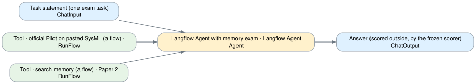

| Card | Component | What it does |
|---|---|---|
| Task statement (one exam task) | `ChatInput` | The task text as the exam gives it; bench/langflow_exam.py sends the 27 sealed tasks here, three times each. |
| Tool · official Pilot on pasted SysML (a flow) · Paper 3 | `RunFlow` | Runs the flow "Validate SysML with the official Pilot": the pasted text saved as a file → the official SysML v2 Pilot → PASS or FAIL with the diagnostics. |
| Tool · search memory (a flow) · Paper 2 | `RunFlow` | Runs the flow "Memory search": the memory library → MiniLM + FAISS seeds → one hop of neighbours → cards. Open it to see each step. |
| Langflow Agent with memory exam · Langflow Agent · qwen3.8-flash | `Agent` | Langflow's own Agent component: the model decides which card to call and when; the cards decide nothing by themselves. Model: Qwen's cloud endpoint. Token usage is stored on each answer (time and money per task). |
| Answer (scored outside, by the frozen scorer) | `ChatOutput` |  |

**On the canvas:** Langflow's Agent sitting the 27-task exam with memory (decision 035): the exam prompt (tools/assistant/rtrc-assistant-exam.md plus the frozen rules of agents/solve.py), qwen3.8-flash (the model of the frozen exam), and two tools as flows: **Validate SysML with the official Pilot** and **Memory search** (paper 2 retrieval over MaritimeISR and the approved designs). No design pipeline, no write to memory, no knowledge-base card.

- The same prompt and the same two tools as **OpenCode with memory exam**, so the two columns on results page 1.3 compare the harnesses, not the tools.
- Run the whole exam with `python3 bench/langflow_exam.py --flow "Langflow Agent with memory exam"`: 27 tasks × 3 repeats, a fresh session per task, scored by the frozen scorer; time and tokens (the Agent's usage field) recorded per task. The answer keys never enter the prompt.
- One task by hand: paste its statement in the Playground; nothing is scored there.

### Langflow Agent with memory chat · qwen3.8-max

`chat` · file [`4-langflow-agent-with-memory/langflow-agent-memory-chat-max.json`](../../langflow/flows/4-langflow-agent-with-memory/langflow-agent-memory-chat-max.json) · 13 cards · The assistant with its parts on the canvas: Langflow's Agent (qwen3.8-max), one card per RTRC tool, the memory knowledge base, the design pipeline as a flow run as a tool; write to memory pauses for approval.

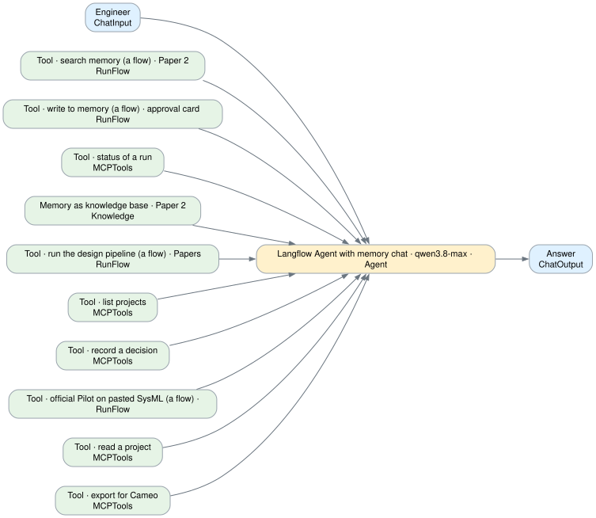

| Card | Component | What it does |
|---|---|---|
| Engineer | `ChatInput` | Ask, describe a need, confirm a brief, or decide. |
| Tool · search memory (a flow) · Paper 2 | `RunFlow` | Runs the flow "Memory search": the memory library → MiniLM + FAISS seeds → one hop of neighbours → cards. Open it to see each step. |
| Tool · write to memory (a flow) · approval card · Paper 2 | `RunFlow` | Pauses for your approval, then runs the flow "Write to memory": the gate (Pilot PASS, four checks PASS) → the write → the record → the knowledge base refreshed with the new cards. |
| Tool · status of a run | `MCPTools` | What a saved run produced (analysis/discover-<run>.json): path, requirements, each design's Pilot result and checks, the decision. |
| Memory as knowledge base · Paper 2 | `Knowledge` | Langflow's semantic search over the same cards (Qwen embeddings, filled by the knowledge-base fill flow and by the write-to-memory flow). |
| Tool · run the design pipeline (a flow) · Papers 2, 3, 1 | `RunFlow` | Runs the flow "Design pipeline": ① memory → ② requirements → ③ designs by OpenCode in the sandbox (its rules, template and examples shown as cards) → ④ official Pilot → ⑤ alignment → ⑥ checks → trade-offs → ⑦ review. Ope… |
| Tool · list projects | `MCPTools` | What is in the memory: MaritimeISR and every approved design, with card counts. Reads analysis/memory/approved.jsonl. |
| Tool · record a decision | `MCPTools` | Saves Reject or Send back with the engineer's reason on the run's record (page 2.3). |
| Langflow Agent with memory chat · qwen3.8-max · Langflow Agent · qwen3.8-max | `Agent` | Langflow's own Agent component: the model decides which card to call and when; the cards decide nothing by themselves. Model: Qwen's cloud endpoint. |
| Tool · official Pilot on pasted SysML (a flow) · Paper 3 | `RunFlow` | Runs the flow "Validate SysML with the official Pilot": the pasted text saved as a file → the official SysML v2 Pilot → PASS or FAIL with the diagnostics. |
| Tool · read a project | `MCPTools` | The SysML v2 text of MaritimeISR or of an approved design, from the file itself. |
| Tool · export for Cameo | `MCPTools` | Writes a run's passing designs as .sysml files for Cameo's SysML v2 edition (when RTRC provides the license). |
| Answer | `ChatOutput` |  |

**On the canvas:** The same assistant as **OpenCode with memory chat**, with its parts on the canvas: Langflow's own Agent in the middle, one card per RTRC tool around it, the memory as a knowledge base, and four tools that are flows of their own (project 5).

- Talk to it like a colleague: ask what exists, describe a need, answer its questions about missing numbers, confirm the brief it proposes, decide on the result. Model: Qwen's cloud endpoint.
- Flows run as tools, open them to see each step: **Memory search** (library → MiniLM + FAISS seeds → one hop → cards, paper 2); **Design pipeline** (① memory → ② requirements → ③ designs by OpenCode in the sandbox, with the rules, template and examples it was given shown as cards → ④ Pilot → ⑤ alignment → ⑥ checks → trade-offs → ⑦ review; the results page 8770 may stay open); **Validate SysML with the official Pilot** (file → official Pilot, paper 3); **Write to memory** (gate → write → record → knowledge base refreshed). Edit a flow and this assistant runs the edited version.
- **Tool · write to memory** pauses for your approval (its Actions row): the AGENTS.md gate as a card. Every answer shows the tools it called when you expand it in the Playground.
- It never invents numbers and never moves a stated limit; verdicts come from the official Pilot and the checks. Records appear on page 2.3.

### Langflow Agent with memory chat · local Qwen3.8-27B

`chat` · file [`4-langflow-agent-with-memory/langflow-agent-memory-chat-local.json`](../../langflow/flows/4-langflow-agent-with-memory/langflow-agent-memory-chat-local.json) · 13 cards · The assistant with its parts on the canvas: Langflow's Agent (local Qwen3.8-27B), one card per RTRC tool, the memory knowledge base, the design pipeline as a flow run as a tool; write to memory pauses for approval.

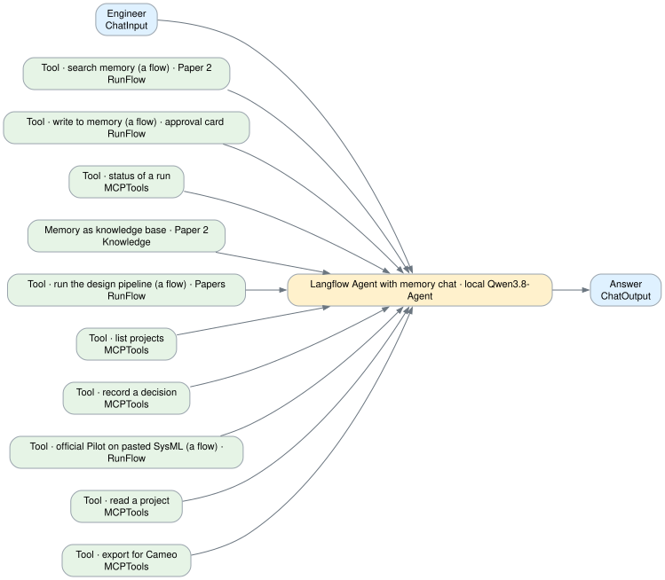

| Card | Component | What it does |
|---|---|---|
| Engineer | `ChatInput` | Ask, describe a need, confirm a brief, or decide. |
| Tool · search memory (a flow) · Paper 2 | `RunFlow` | Runs the flow "Memory search": the memory library → MiniLM + FAISS seeds → one hop of neighbours → cards. Open it to see each step. |
| Tool · write to memory (a flow) · approval card · Paper 2 | `RunFlow` | Pauses for your approval, then runs the flow "Write to memory": the gate (Pilot PASS, four checks PASS) → the write → the record → the knowledge base refreshed with the new cards. |
| Tool · status of a run | `MCPTools` | What a saved run produced (analysis/discover-<run>.json): path, requirements, each design's Pilot result and checks, the decision. |
| Memory as knowledge base · Paper 2 | `Knowledge` | Langflow's semantic search over the same cards (Qwen embeddings, filled by the knowledge-base fill flow and by the write-to-memory flow). |
| Tool · run the design pipeline (a flow) · Papers 2, 3, 1 | `RunFlow` | Runs the flow "Design pipeline": ① memory → ② requirements → ③ designs by OpenCode in the sandbox (its rules, template and examples shown as cards) → ④ official Pilot → ⑤ alignment → ⑥ checks → trade-offs → ⑦ review. Ope… |
| Tool · list projects | `MCPTools` | What is in the memory: MaritimeISR and every approved design, with card counts. Reads analysis/memory/approved.jsonl. |
| Tool · record a decision | `MCPTools` | Saves Reject or Send back with the engineer's reason on the run's record (page 2.3). |
| Langflow Agent with memory chat · local Qwen3.8-27B · Langflow Agent · local Qwen3.8-27B | `Agent` | Langflow's own Agent component: the model decides which card to call and when; the cards decide nothing by themselves. Model: the 3-bit model on this machine (scripts/qwen38.sh --serve). |
| Tool · official Pilot on pasted SysML (a flow) · Paper 3 | `RunFlow` | Runs the flow "Validate SysML with the official Pilot": the pasted text saved as a file → the official SysML v2 Pilot → PASS or FAIL with the diagnostics. |
| Tool · read a project | `MCPTools` | The SysML v2 text of MaritimeISR or of an approved design, from the file itself. |
| Tool · export for Cameo | `MCPTools` | Writes a run's passing designs as .sysml files for Cameo's SysML v2 edition (when RTRC provides the license). |
| Answer | `ChatOutput` |  |

**On the canvas:** The same assistant as **OpenCode with memory chat**, with its parts on the canvas: Langflow's own Agent in the middle, one card per RTRC tool around it, the memory as a knowledge base, and four tools that are flows of their own (project 5).

- Talk to it like a colleague: ask what exists, describe a need, answer its questions about missing numbers, confirm the brief it proposes, decide on the result. Model: the 3-bit model on this machine (scripts/qwen38.sh --serve).
- Flows run as tools, open them to see each step: **Memory search** (library → MiniLM + FAISS seeds → one hop → cards, paper 2); **Design pipeline** (① memory → ② requirements → ③ designs by OpenCode in the sandbox, with the rules, template and examples it was given shown as cards → ④ Pilot → ⑤ alignment → ⑥ checks → trade-offs → ⑦ review; the results page 8770 may stay open); **Validate SysML with the official Pilot** (file → official Pilot, paper 3); **Write to memory** (gate → write → record → knowledge base refreshed). Edit a flow and this assistant runs the edited version.
- **Tool · write to memory** pauses for your approval (its Actions row): the AGENTS.md gate as a card. Every answer shows the tools it called when you expand it in the Playground.
- It never invents numbers and never moves a stated limit; verdicts come from the official Pilot and the checks. Records appear on page 2.3.

### Langflow Agent with memory chat · qwen3.8-max · one MCP card (decision 031)

`chat` · file [`4-langflow-agent-with-memory/rtrc-assistant-langchain.json`](../../langflow/flows/4-langflow-agent-with-memory/rtrc-assistant-langchain.json) · 5 cards · Comparison: the assistant of decision 031 on Langflow's own Agent component (qwen3.8-max) with the RTRC tools on one MCP card, run_design with agent direct; the OpenCode assistant is the one for use.

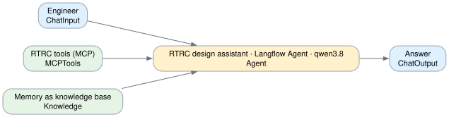

| Card | Component | What it does |
|---|---|---|
| Engineer | `ChatInput` | Ask, describe a need, confirm a brief, or decide. |
| RTRC tools (MCP) | `MCPTools` | tools/assistant_mcp.py: memory search and projects, the verified design pipeline, the official Pilot, memory write, decisions, Cameo export. |
| Memory as knowledge base | `Knowledge` | Langflow's semantic search over the same 152 cards (Qwen embeddings). |
| RTRC design assistant · Langflow Agent · qwen3.8-max | `Agent` | Langflow's own Agent component (LangChain create_agent on LangGraph): the model decides which tool to call and when; the tools decide nothing by themselves. Comparison with the OpenCode assistant; run_design here uses ag… |
| Answer | `ChatOutput` |  |

**On the canvas:** The assistant of decision 031, kept next to **OpenCode with memory chat** (OpenCode on the local Qwen3.8-27B, decision 032) so the two harnesses can be compared on the same tools and rules. The unfolded versions in this project show the same tools one card each.

- Outside: Langflow's own Agent component on qwen3.8-max (cloud). Inside: `run_design` with agent `direct`, the model writing each design in one answer with the Pilot's error list sent back, as in 031. The OpenCode assistant has OpenCode write the designs with `./validate` in hand.
- Same tools (MCP server 127.0.0.1:8782), same rules: it never invents numbers, never moves a stated limit, and writes to memory only after you approve a design that passed all four checks. Its record appears on page 2.3.
- Set-up: `langflow/flows/setup_assistant.py` (the Qwen credential and the MCP registration in Langflow), then `move_to_user.py` for the account people log in with.

## 6 · Other

The design agent flow with the person's decision at ⑧ (cloud Qwen, and the local Qwen3.8-27B via OpenCode), the knowledge-base fill, the exam results tables, the MOD change chain, the Cameo check.

Folder: [`langflow/flows/6-other/`](../../langflow/flows/6-other/)

### Design agent flow with a person's decision

`other` · file [`6-other/other-design-agent-flow.json`](../../langflow/flows/6-other/other-design-agent-flow.json) · 22 cards · Part 2 of the results page as a Langflow flow: memory search, new or reuse, the official Pilot loop, alignment, checks, a person's decision, memory, grades and times.

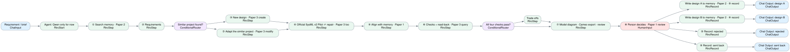

| Card | Component | What it does |
|---|---|---|
| Requirement / brief | `ChatInput` | Type the mission brief. Empty: the default brief of the 2.2 design space. |
| ⑥ Checks + read-back · Paper 3 query | `RtrcStep` | Power, upload, storage and trace from numbers in the official parse; the model restates its model. Starts with pass or fail. |
| Agent: Qwen only for now | `RtrcStart` | Qwen direct, or Claude Code / OpenCode on Qwen in the sandbox. Or replay a saved run without model calls. |
| All four checks pass? | `ConditionalRouter` | True: to review. False: trade-offs first. |
| ① Search memory · Paper 2 | `RtrcStep` | Cards from the official parse of MaritimeISR and approved designs; MiniLM + FAISS, cosine ≥ 0.30 plus the exact-name bonus; seeds plus one hop. |
| Trade-offs | `RtrcStep` | Three proposals from catalog parts only; code recomputes each one; the 60 W limit never changes. |
| ② Requirements | `RtrcStep` | Numbered requirements; every number must come from the brief. The message starts with reuse or new. |
| ⑦ Model diagram · Cameo export · review | `RtrcStep` | Diagram drawn from the official parse; the design exported for Cameo (when licensed); the approval text. Saves the run for page 2.3. |
| Similar project found? | `ConditionalRouter` | True (reuse): adapt the similar project. False (new): write a new design. |
| ⑧ Person decides · Paper 1 review | `HumanInput` | The run pauses here with the review text. Approve writes the design to memory; Send back returns the brief with a trade-off. |
| ③ New design · Paper 3 create | `RtrcStep` | Rules + template (attribute contract) + retrieved examples + brief and requirements. A literal, B another arrangement. |
| ③ Adapt the similar project · Paper 3 modify | `RtrcStep` | Design A edits the similar project's model; design B is written new for comparison. |
| Write design A to memory · Paper 2 · ⑨ record | `RtrcRecord` | Refused unless all four checks passed; an approved design becomes retrievable cards. Then saves the decision, grades and times. |
| Write design B to memory · Paper 2 · ⑨ record | `RtrcRecord` | Refused unless all four checks passed. Then saves the decision, grades and times. |
| ⑨ Record: rejected | `RtrcRecord` | Saves the decision with every stage's verdict, attempts, seconds, model calls and cost. |
| ⑨ Record: sent back | `RtrcRecord` | Saves the decision; change the brief or pick a trade-off and run again. |
| ④ Official SysML v2 Pilot ⇄ repair · Paper 3 loop | `RtrcStep` | The Pilot is the judge. A failed parse sends the complete error list back in the same conversation, up to 20 times. Every attempt is listed. |
| Chat Output: design A | `ChatOutput` | Grades and times. |
| Chat Output: design B | `ChatOutput` | Grades and times. |
| Chat Output: rejected | `ChatOutput` | Grades and times. |
| Chat Output: sent back | `ChatOutput` | Grades and times. |
| ⑤ Align with memory · Paper 1 | `RtrcStep` | The model proposes pairs; code checks both names and writes an alias / allocate package; the Pilot parses it with both sources. |

**On the canvas:** A requirement becomes an approvable SysML v2 design. Two cases: **new** (nothing similar in memory, start from scratch) or **reuse** (adapt the similar project found in memory).

- Every RTRC node calls the code behind the results page through the RTRC shell service (`bench/shell_service.py`), so a run here and a run on the page give the same retrieval, prompts, Pilot results and checks.
- **Qwen only for now** (RTRC has not answered which models may be used).
- Click a node after a run to read what it did: the retrieved cards, every Pilot attempt and its errors, the alignment pairs, the checks.
- Replay any saved run without model calls: set *Replay a saved run* in the Agent node to `latest` or a run id.

### Design agent flow · local Qwen3.8-27B via OpenCode

`other` · file [`6-other/other-design-agent-flow-local.json`](../../langflow/flows/6-other/other-design-agent-flow-local.json) · 22 cards · The design agent flow with every model call on this machine: OpenCode in the sandbox on the 3-bit Qwen3.8-27B served by Ollama; memory search, new or reuse, the official Pilot, alignment, checks, a person's decision, memory, grades and times.

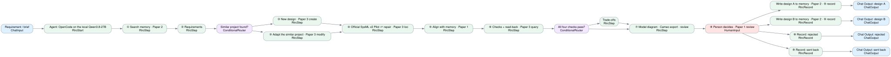

| Card | Component | What it does |
|---|---|---|
| Requirement / brief | `ChatInput` | Type the mission brief. Empty: the default brief of the 2.2 design space. |
| ⑥ Checks + read-back · Paper 3 query | `RtrcStep` | Power, upload, storage and trace from numbers in the official parse; the model restates its model. Starts with pass or fail. |
| Agent: OpenCode on the local Qwen3.8-27B | `RtrcStart` | OpenCode in the sandbox, on the 3-bit Qwen3.8-27B that Ollama serves on this machine (scripts/qwen38.sh --serve). The other steps use the same local model. Or replay a saved run without model calls. |
| All four checks pass? | `ConditionalRouter` | True: to review. False: trade-offs first. |
| ① Search memory · Paper 2 | `RtrcStep` | Cards from the official parse of MaritimeISR and approved designs; MiniLM + FAISS, cosine ≥ 0.30 plus the exact-name bonus; seeds plus one hop. |
| Trade-offs | `RtrcStep` | Three proposals from catalog parts only; code recomputes each one; the 60 W limit never changes. |
| ② Requirements | `RtrcStep` | Numbered requirements; every number must come from the brief. The message starts with reuse or new. |
| ⑦ Model diagram · Cameo export · review | `RtrcStep` | Diagram drawn from the official parse; the design exported for Cameo (when licensed); the approval text. Saves the run for page 2.3. |
| Similar project found? | `ConditionalRouter` | True (reuse): adapt the similar project. False (new): write a new design. |
| ⑧ Person decides · Paper 1 review | `HumanInput` | The run pauses here with the review text. Approve writes the design to memory; Send back returns the brief with a trade-off. |
| ③ New design · Paper 3 create | `RtrcStep` | Rules + template (attribute contract) + retrieved examples + brief and requirements. A literal, B another arrangement. |
| ③ Adapt the similar project · Paper 3 modify | `RtrcStep` | Design A edits the similar project's model; design B is written new for comparison. |
| Write design A to memory · Paper 2 · ⑨ record | `RtrcRecord` | Refused unless all four checks passed; an approved design becomes retrievable cards. Then saves the decision, grades and times. |
| Write design B to memory · Paper 2 · ⑨ record | `RtrcRecord` | Refused unless all four checks passed. Then saves the decision, grades and times. |
| ⑨ Record: rejected | `RtrcRecord` | Saves the decision with every stage's verdict, attempts, seconds, model calls and cost. |
| ⑨ Record: sent back | `RtrcRecord` | Saves the decision; change the brief or pick a trade-off and run again. |
| ④ Official SysML v2 Pilot ⇄ repair · Paper 3 loop | `RtrcStep` | The Pilot is the judge. A failed parse sends the complete error list back in the same conversation, up to 20 times. Every attempt is listed. |
| Chat Output: design A | `ChatOutput` | Grades and times. |
| Chat Output: design B | `ChatOutput` | Grades and times. |
| Chat Output: rejected | `ChatOutput` | Grades and times. |
| Chat Output: sent back | `ChatOutput` | Grades and times. |
| ⑤ Align with memory · Paper 1 | `RtrcStep` | The model proposes pairs; code checks both names and writes an alias / allocate package; the Pilot parses it with both sources. |

**On the canvas:** The design agent flow with every model call on this computer: the 3-bit Qwen3.8-27B served by Ollama (`scripts/qwen38.sh --serve`), and OpenCode in the bubblewrap sandbox writing the designs with `./validate` (the official Pilot) in hand, up to 60 turns per design. Nothing leaves the machine.

- Same nodes, same shell service, same checks as **Design agent flow with a person's decision**; only the Agent node's presets differ (OpenCode, qwen3.8-27b (Ollama)).
- Direct writing with the 27B got stuck on `part usage vessel` for 20 identical repairs (run 20261007T014335); OpenCode gets the Pilot's errors as a tool result and edits the file (decision 032).
- The results page (8770) may stay open: the sandbox has its own network and cannot reach the page's answer keys.
- Click a node after a run to read what it did; replay a saved run with *Replay a saved run* = `latest` or a run id.

### Memory knowledge base fill

`other` · file [`6-other/other-memory-knowledge-base.json`](../../langflow/flows/6-other/other-memory-knowledge-base.json) · 3 cards · The library the agent searches: MaritimeISR and approved designs as cards, mirrored into a Langflow knowledge base.

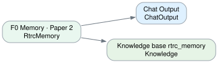

| Card | Component | What it does |
|---|---|---|
| F0 Memory · Paper 2 | `RtrcMemory` | MaritimeISR plus every approved design, as element cards from the official parse, with their links. |
| Chat Output | `ChatOutput` | The memory's sources and size. |
| Knowledge base rtrc_memory | `Knowledge` | The cards as Langflow's own knowledge base, embedded by Qwen (qwen3.7-text-embedding). Rows already there are skipped. |

**On the canvas:** The memory is the existing MaritimeISR model plus every design a person approved, parsed by the official Pilot into element cards (type, full name, value or connection ends, documentation text) with their links.

- Running this flow fills the Langflow knowledge base **rtrc_memory** (Knowledge page): the card text is embedded by Qwen, the other columns are kept as metadata, and cards already there are skipped. Run it again after a design is approved outside the write-to-memory flow.
- The design flows' ① Search memory always uses our own retrieval (MiniLM + FAISS, seeds + one hop), so its results match the results page.

### Exam results tables

`exam` · file [`6-other/other-exam-results.json`](../../langflow/flows/6-other/other-exam-results.json) · 2 cards · The frozen exam results as tables.

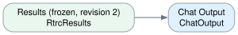

| Card | Component | What it does |
|---|---|---|
| Results (frozen, revision 2) | `RtrcResults` | Pass rates by task type and approach for the four candidates, the retry run and the cost. |
| Chat Output | `ChatOutput` | Display a chat message in the Playground. |

**On the canvas:** The frozen results of the 27-task exam: direct qwen3.8-flash and qwen3.8-max (P0–P3, three repeats), OpenCode and Claude Code on qwen3.8-flash in the sandbox, and the extra retry run. The matrix (with the Langflow exam columns of decision 035), the cost chart and the model diagrams stay on the results page (`python3 bench/exam_board.py`).

### MOD change chain

`other` · file [`6-other/other-mod-change-chain.json`](../../langflow/flows/6-other/other-mod-change-chain.json) · 14 cards · One change to an existing model, judged, read back and gated.

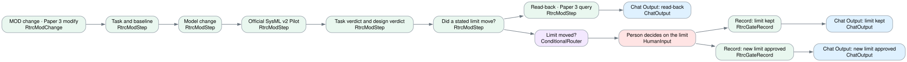

| Card | Component | What it does |
|---|---|---|
| MOD change · Paper 3 modify | `RtrcModChange` | MOD-01 to MOD-05: the model edits an existing model. Replay the latest run, or run it again on Qwen (two model calls). |
| Record: limit kept | `RtrcGateRecord` | The change is not accepted; the stated limit stays. |
| Record: new limit approved | `RtrcGateRecord` | Only a person can approve a changed limit (AGENTS.md). |
| Task and baseline | `RtrcModStep` | One step of the MOD change chain, from the case record. |
| Chat Output: limit kept | `ChatOutput` | Display a chat message in the Playground. |
| Chat Output: new limit approved | `ChatOutput` | Display a chat message in the Playground. |
| Model change | `RtrcModStep` | One step of the MOD change chain, from the case record. |
| Official SysML v2 Pilot | `RtrcModStep` | One step of the MOD change chain, from the case record. |
| Task verdict and design verdict | `RtrcModStep` | Task verdict: the sealed key's checklist. Design verdict: the budget. MOD-05 is over budget by construction; an honest answer passes the task. |
| Did a stated limit move? | `RtrcModStep` | Starts with moved or unchanged. |
| Read-back · Paper 3 query | `RtrcModStep` | The model restates the changed model; code checks every number. |
| Limit moved? | `ConditionalRouter` | True: a person must decide before the change is accepted. False: nothing to decide. |
| Chat Output: read-back | `ChatOutput` | Display a chat message in the Playground. |
| Person decides on the limit | `HumanInput` | Only reached when the answer changed a stated limit. In the exam no answer did. |

**On the canvas:** The model edits a task's baseline model; the official Pilot judges the syntax; the sealed key gives the task verdict and the budget gives the design verdict; the model reads the edited model back and code checks every number. If the answer moved a stated limit, a person must decide before the change is accepted (AGENTS.md: propose it and stop).

### Cameo check

`other` · file [`6-other/other-cameo-check.json`](../../langflow/flows/6-other/other-cameo-check.json) · 9 cards · Export a run's designs for Cameo and record the person's check.

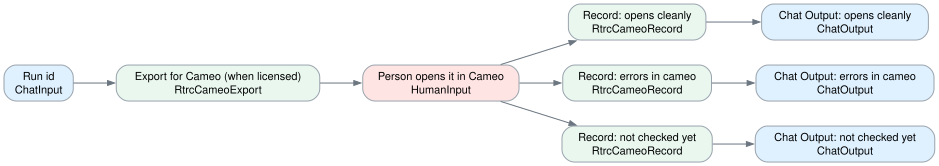

| Card | Component | What it does |
|---|---|---|
| Run id | `ChatInput` | Type a saved run id, for example 20261006T211951. |
| Export for Cameo (when licensed) | `RtrcCameoExport` | Writes the run's passing designs as .sysml files for Cameo's SysML v2 edition. |
| Person opens it in Cameo | `HumanInput` | Open the exported file in Cameo's SysML v2 edition and pick the result. Until RTRC provides the license: Not checked yet. |
| Record: opens cleanly | `RtrcCameoRecord` | Stored next to the official Pilot's verdict as agreement (interoperability). |
| Record: errors in cameo | `RtrcCameoRecord` | Stored next to the official Pilot's verdict as agreement (interoperability). |
| Record: not checked yet | `RtrcCameoRecord` | Stored next to the official Pilot's verdict as agreement (interoperability). |
| Chat Output: opens cleanly | `ChatOutput` | Display a chat message in the Playground. |
| Chat Output: errors in cameo | `ChatOutput` | Display a chat message in the Playground. |
| Chat Output: not checked yet | `ChatOutput` | Display a chat message in the Playground. |

**On the canvas:** RTRC works in Cameo. This flow exports a run's officially parsed designs and records whether they open cleanly in Cameo's SysML v2 edition. The official Pilot stays the judge; Cameo's result is recorded as agreement, the interoperability evidence the brief asks for. Cameo has no headless command, so a person opens the file.

