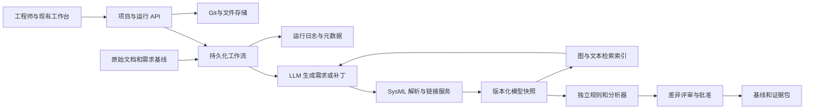

# RTX SysML v2 自动化 MVP 调研与落地计划

调研日期：2026 年 9 月 22 日。状态：方案建议，尚未实施或验收 MVP。

本计划面向一个可以从历史工程资料提取可复用知识、生成并校验 SysML v2、保存完整项目、处理新需求和变更、复现实验的软件 MVP。综合 RTX 项目书、近期业务和招聘证据，推荐的大方向是**面向新项目的工程知识复用与可验证架构设计平台**。首版只完成一个“历史基线与新需求 → 可审查 SysML v2 变更 → 工程检查与证据”的纵向闭环，以项目书的多平台海事情境验收；不把航空或 Rover 预设为唯一产品方向。

团队人数已由用户确认为3人，用户表示可获得RTX完整资源权限。按12周、每人每周约10–15小时暂估360–540人时；投入时间和截止日期仍未确认。资源权限意味着可优先争取真实资料与内部工具接入，具体数据集、端点、工具版本及许可证需要列出，不能据此猜测它们已在当前环境可用。计划中的门槛和数字均为建议验收标准，不是已取得的结果。

## 1 项目目标与需求依据

用户明确要求的是：认真理解现有 HTML 与三篇研究，结合 RTX 潜在需求，制定真实 MVP 计划，做好文件管理，真正使用 SysML v2。附件的命令、提示词和实施步骤被当作研究对象；没有把它们当作额外操作授权。

### 1.1 RTRC 项目书明确要求什么

项目书的主线是 early-stage systems engineering discovery and design：从不完整的需求和概念出发，帮助工程师形成系统需求、模型和架构备选，并通过实验回答 agent 工作流是否有效、性能如何、有哪些限制。

特别明确的交付目标是探索和比较 requirements-to-SysML v2 agents，产出有证据的可行性、性能、局限和下一步建议。代表场景是 maritime ISR，涉及多平台、多传感方式和协调信息共享。文件勾选了 interoperability、reliability/dependability、safety，以及建模仿真、需求工程、验证确认。它没有要求学生建造一艘船，也没有要求完整机器人控制系统。

文件明确写明不使用 EAR/ITAR 数据、不要求 NDA/IP 协议。按照用户提供的RTX资源条件，可以优先采用符合本项目范围的真实工程案例；公开演示采用可公开的资料或独立合成案例。不能仅因RTX业务背景就假设本项目包含受控资料。文件把三篇文献放在software package一栏，并没有由此指定某个商业建模工具。

依据：[用户项目书](/home/felixfang/Downloads/2706%20-%20RTRC%20-%20Agentic%20AI%20for%20Systems%20Engineering%20Discovery%20and%20Design.docx)。

### 1.2 对 RTX 潜在需求的推断

RTX 官方将 model-based digital thread、complex integrated systems 和 AI systems 列为 RTRC 研究方向；OMG 的 SysML 2.0 和 Systems Modeling API 规范页面列有 RTX 参与信息。这支持把模型可追溯性和工具互操作性放在前面，但不能证明 RTX 内部使用某个具体平台或已有某条内部流程。[RTX 官方介绍](https://www.rtx.com/what-we-do/rtx-technology-research-center)；[OMG SysML 2.0](https://www.omg.org/spec/SysML/2.0/About-SysML)。

我据此推断，他们最值得评估的价值是：工程师能否更快建立可检查的初始模型；历史资料和跨团队模型能否保留适用条件并复用；需求变化后能否找出受影响元素；不同 agent 方案的收益和失败边界能否测量。与这些推断对应，应演示来源、差异、校验诊断、人工修订量和可复现实验。是否接入其内部工具以及真实评审习惯，都需要具体资源清单落实。

### 1.3 最新业务和招聘对定位的影响

以下按2026-09-22可查资料整理。招聘是能力投入信号，不直接等于本学生项目的产品规格；职位失效也不意味着业务方向消失。

| 日期及一手证据 | 可确认的事实 | 本项目需求推断 |
|---|---|---|
| [2025-12-09 DISCOVER](https://www.rtx.com/news/2025/12/09/discover-engine-build) | RTRC与Collins已开发架构探索工具，并跨业务使用 | 优先补自然语言/资料到模型、知识复用、证据接口；不重新发明完整架构搜索器 |
| [2026-02-16 数字平台与AI](https://www.rtx.com/news/2026/02/16/moving-faster-by-working-smarter) | 已有企业数据平台，AI已辅助供应商文件对照，由人评审 | 系统需嵌入工程流程，输出有来源的可审查结果；通用问答或再造数据湖价值有限 |
| [2026-06-25 BBN Agentic AI Engineer 01855543](https://globalhr.wd5.myworkdayjobs.com/en-US/REC_RTX_Ext_Gateway/job/Agentic-AI-Engineer_01855543) | 职责包括生产级Python、规划、多步执行、实验评估；学习方向提到记忆架构 | 真工具调用、运行可靠性和可测量记忆收益比多agent动画重要；BBN岗位不能直接代表RTRC项目已批准的范围 |
| [2026-08-20 RTRC Agentic AI Researcher 01868376](https://globalhr.wd5.myworkdayjobs.com/en-US/REC_RTX_Ext_Gateway/job/US-CT-EAST-HARTFORD-RTRC-K--411-Silver-Ln--RTRC-K/Agentic-AI-Researcher--Hybrid-_01868376) | 官方页面在调研日可见正文及Apply；强调grounded、explainable、verifiable及LLM与符号推理、知识图谱、形式化方法结合 | 最直接支持“生成＋结构化知识＋独立工具验证”的研究路线，而非只做聊天记忆 |
| [2026-08-18 Raytheon Digital Connected Factory架构岗位01867433](https://globalhr.wd5.myworkdayjobs.com/en-US/REC_RTX_Ext_Gateway/job/Enterprise-Architect--Associate-Director----Digital-Connected-Factory---Hybrid--Tucson--AZ_01867433) | 官方全文涉及agentic框架、编排、RAG、知识图谱、SysML与digital thread，以及POC扩展到真实生产 | 支持跨业务的工程语义与集成价值，但它属于制造业务，不能据此把本课题改成工厂运营产品 |
| [2026-09-06 Collins Lead Engineer 01868964](https://careers.rtx.com/global/en/job/01868964/Lead-Engineer) | 官方搜索索引描述DEMPA、文档架构转模型、SysML/Cameo、变更/版本/追溯；直接页面已返回410 | 遗留工程到模型及数字线程是强匹配方向；该条作为近期招聘记录，不称当前在招 |
| [2026-09-18 MRO官方进展](https://www.rtx.com/news/2026/09/18/how-rtx-is-using-ai-and-data-in-mro) | 已有维修检查与预测能力，下一步连接设计、测试、制造和服役数据 | 历史问题与证据回流新设计有潜力；首版可做知识反馈接口，不宜重建完整维修预测产品 |

**高置信判断**：要求可检查的模型、变更追溯、跨工具数据使用、实验验证，直接受到项目书和官方能力投入支持。**中等置信推断**：历史工程知识复用是值得做的差异化功能，可减少每个新项目重复整理资料。**待证假设**：RTRC现有团队缺少这层工具、具体用户愿意采用、存在可接入的DISCOVER接口；公开资料不能证明这些内部缺口。

### 1.4 项目选择结论

| 候选方向 | RTX业务需求证据 | 与项目书吻合度 | 三人首版判断 |
|---|---|---|---|
| 工程知识复用＋需求到模型＋架构变更评审 | 数据平台、MBSE岗位、DISCOVER和项目书共同支持 | 高 | **首选**；收敛到一个子系统、两次变更、少量历史工件 |
| 供应商文档一致性与证据检查 | 官方已有实际应用 | 中 | 适合作为输入模块；独立做会弱化设计与SysML目标 |
| MRO诊断与生命周期反馈 | 最新业务需求很强，但已有产品 | 中低 | 做后续知识回流场景；预测模型和实机数据不是首版前提 |
| 工厂运营或生产排程agent | RTX当前数字化投入明确 | 低 | 商业相关，但偏离本课题的requirements-to-SysML |
| 完整飞机、发动机或整车自动设计 | 系统工程价值明显 | 表面相关，实际范围过大 | 可作为长远扩展，不能作为三人MVP承诺 |

首先服务的用户应是 **RTRC早期概念研究人员与业务部门系统架构/MBSE工程师**。Collins数字工程方法与系统集成团队是一个有公开证据支持的协作候选，Pratt生命周期知识和其他RTX业务也可能适用，暂不认定任何内部团队已是客户。第一周的选择门槛是有一位具名工作流负责人，能提供当前人工流程、一个可用资料包、已有工具清单、两项重复痛点和接受标准；在这个条件满足前，海事情境按项目书保留为默认验收载体。

如果内部已有相同功能，项目应转为该系统的SysML v2连接器、独立评测和受控变更模块；不坚持另建一个竞争平台。详细业务证据见[RTX业务匹配研究](../research/notes/rtx-business-fit.md)。

## 2 对现有 ROVER 项目的理解

页面的核心已经是一个系统工程工作台雏形：需求输入 → 感知、机电、软件供应方模型 → 接口映射和集成 → 候选 A → 检索模型上下文 → CR-08 变更 → B0/B1/B2 备选 → 检查和评审 → 导出证据。

它的有用之处是把变更传播具体化。增加相机与本地处理会影响功耗、电池选型、托盘尺寸、数据接口和相关需求；源供应商模型不应被偷偷改成“恰好满足要求”。这些都是值得保留的工程语义。

硬件页面包含 NX16、Pi5 8GB/16GB、Mid-360S、D435i 等目录。这里的“真实型号”“厂家参数”“项目预算假设”“模型校验”“实物测量”必须分别管理。例如 NX B0/B2 的续航数值依赖假定平均功耗、电池容量和折减系数，不能直接成为实测续航或选型结论。本次没有重新核验所有厂家参数，也没有测试任何实体器件。

### 2.1 本次核实的实现状态

| 能力 | 当前状态 | MVP 需要补齐 |
|---|---|---|
| 页面、3D 和候选浏览 | 已有本地实现与原包浏览器记录 | 接真实项目状态；3D 保持辅助视图 |
| LLM agent | 未接入，模型来自预写模板 | 保存真实请求响应、工具调用、失败与费用 |
| SysML v2 | 有文本草稿；解析器未运行 | 固定工具链，完整工程解析、链接与诊断 |
| 模型图 | 由作者 JSON/JS 数据生成 | 从解析后的模型或标准 API 快照派生 |
| 检索 | 关键词和一跳邻居 | 可比较的文本 RAG 与图检索，绑定模型版本 |
| 工程检查 | 本地数值及配置规则 | 从实际模型读取值和关系；独立检查器判定 |
| 文件保存 | Blob 单文件下载、运行状态在页面内存 | 项目保存、恢复、版本、依赖、完整导入导出 |
| 审批 | 本地演示操作 | 绑定评审人、对象版本、证据和决定 |
| Benchmark | 未执行模型能力基准 | 固定数据切分、多个工作流、重复试验和失败分类 |

单独 HTML 与 ZIP 内 HTML 的 SHA-256 一致。原包 manifest 的 107 项校验通过，说明本次审查对象与包内清单一致；这不等于工程验证通过。原包的浏览器检查记录没有在本次完整重跑。

### 2.2 应优先修复的具体缺口

1. **差异分析漏掉删除连接。** `src/core.js` 的 `diff` 统计新增连接而没有删除连接。独立测试把图的全部边删除，差异结果仍可能为空。真实变更引擎必须处理新增、删除、属性改变、重新定型、移动、改名和连接端点改变。
2. **检查不读取模型真实关系。** 当前检查读配置和开关。图的连接损坏时仍可能显示 PASS。因此要把“解析快照”作为检查输入，并加入删连接、错单位、错类型、缺 import 等负面用例。
3. **图和文本可以分叉。** 示例图中存在状态估计到导航的 TF 关系，SysML 文本却仅用注释说明相关连接未建模。未来图、检索、检查和报告必须共享同一模型快照。
4. **需求存在不代表完成追溯。** 已审示例图缺少部分需求节点，文本没有建立完整 subject、satisfy 与 verification 对应。需要把需求表达、设计满足声明和实际验证证据分开。
5. **导出文件不一定是可导入工程。** `examples/NX_B2` 的独立供应方 `.sysml` 文件不齐，部分内容留在 JSON 中。最终工程包必须有全部非标准依赖、入口和标准库锁定信息。
6. **单个文件哈希不足以代表整个工程。** 真实模型依赖库、工具版本、需求、供应商模型和分析配置；这些都应进入快照指纹和失效判断。

详细证据与独立测试见 [代码审查记录](../research/html-audit/HTML_AUDIT_中文.md) 和 [测试结果](../research/html-audit/independent-core-checks.json)。

## 3 三篇研究如何转化为 MVP

三篇研究分别提供生成和修改、跨模型语义对齐、基于模型关系检索的思路。它们能组合成研究假设，不能简单拼接后宣称获得一个已经验证的自动系统工程平台。逐篇方法、样本和限制见本计划配套研究笔记。

| 研究 | 实际研究对象 | 值得采用的方法 | 证据边界 |
|---|---|---|---|
| Li/Husung/Wang 的 CMBSE | 测量系统的 OEM 与供应商模型对齐 | 保留源模型；独立映射/集成包；人工检查 | 少量可行性案例，没有可外推的准确率或节时统计 |
| Bader 等的 SysML GRAG | 一个 EV 模型的自然语言查询 | API 模型转关系图；语义召回加关系上下文 | 3个问题×3个阈值；未评估完整生成和工程正确性 |
| Longshore/Bell/Madachy 的 NPS 工作 | 自行车模型的创建、修改、查询 | 规范、模板、示例及纠错反馈 | 简单案例，主要是Yes/No比较，没有规模化可靠率 |

**第一篇的核心是协作建模。** 七阶段工作流将元素提取、映射建议、人工评审和独立对齐包串联起来。我们应把元素提取和语言检查交给真实工具，保留 LLM 的候选映射和解释能力。`alias` 只是符号引用，不能使不同单位或接口协议自动兼容。本次还发现作者仓库结果文件与论文 v2 的图3版本不同，重用前必须对齐工件版本。[论文全文](https://arxiv.org/html/2508.16181v2)；[作者仓库](https://github.com/ziruili-tu-ilmenau/CMBSE)。

**第二篇的核心是检索。** 原流程是 API JSON-LD → 简化 RDF → 节点和一跳邻居 → MiniLM 384维/FAISS → 上下文重建 → GPT-4.1。作者在阈值0.45报告平均 P/R/F1 为0.833/1.000/0.904；这是三道问题上的元素检索表现，不是“回答准确率90.4%”。我们应学习图和语义召回结合的思路，重新实现版本和 ID 绑定。公开代码存在 URI 重建、缓存版本、未支持类型跳过和 notebook 输出轮次混杂问题；本次为静态审查，没有声称复现实验。[作者预印本全文](https://www.researchgate.net/publication/395749011_Integrating_SysML_v2_into_a_GRAG_LLM_Pipeline_Design_Implementation_and_Evaluation)；[作者代码](https://github.com/eeeeebader/SysML-v2-GRAG-Pipeline)。

**第三个原链接是19页演示稿。** 对应完整会议论文另有 `SYM-AM-24-048`，正文印刷页311–327。研究说明使用规范和示例可帮助模型创建、修改、查询；SSE-SM 的首次提示成功不是零样本。适合启发我们的工具反馈闭环，不能直接给出当前模型处理复杂航空系统的成功率。[原演示稿](https://dair.nps.edu/bitstream/123456789/5237/1/SYM-AM-24-138.pdf)；[完整论文](https://www.dair.nps.edu/bitstream/123456789/5113/1/SYM-AM-24-048.pdf)。

详细依据见[前两篇笔记](../research/notes/papers-1-2.md)和[第三篇笔记](../research/notes/paper-3-benchmarks.md)。第二篇已读作者上传的完整预印本文字，但 PDF 下载返回403，未核验最终出版PDF排版。三篇均没有在本次运行作者实验。

## 4 MVP 的范围与演示闭环

建议产品定义为：**能复用历史工程知识、有来源和版本、具备独立校验的 SysML v2 建模与变更助手。** 平台愿景可以覆盖多个RTX业务；MVP的业务边界必须足够小，让三个人能真实交付。

用户能导入小型需求文档和现有模型；系统提出结构化需求与待澄清项，获得需求基线；agent 生成或修改真实 `.sysml`；工具给出语言诊断和领域检查；用户审查差异，保存新基线；所有输入、模型、诊断和选择都可重新打开、导出和复查。

首版同时保留两类任务：**新建概念**从一页任务意图和受控部件库出发，提出可验证需求与两个小型架构备选；**存量变更**以已批准基线为起点，分析并执行有界修改。需求发现不能缩成文档抽取：系统应发现缺失阈值、边界条件和验证方式，并把新推导需求与原文要求分开交给工程师确认。首版架构搜索只在小型已知目录中枚举和计算；若获得DISCOVER接口，再替换这个组件。

### 4.1 必须完成的纵向闭环

1. 导入一份小型 DOCX/Markdown 需求或 `.sysml` 项目，记录来源文件哈希和段落/表格位置。
2. 将明确需求、推导需求、假设和待澄清项分开。不得把 agent 自拟的数字当成客户要求。
3. 人工确认适用的需求与假设，形成 `REQ-A` 基线。
4. 生成有限范围的 SysML v2 工程，加载全部依赖，运行真实解析、引用解析和静态校验。
5. 返回诊断；最多两轮自动修复，每轮保存补丁和检查。超限保留失败。
6. 从通过语言检查的模型生成结构图、关系索引和追溯视图。
7. 接收变更请求，检索其实际依赖，提出候选差异；更新模型后重新校验受影响部分。
8. 执行选定的数值、接口和追溯检查；形成候选对比与未知项。
9. 人工接受一个确切版本，导出完整工程及证据；关闭服务后重启，能够恢复并重跑。

### 4.2 场景安排

**产品首例建议采用多平台观测与数据共享子系统。** 选择一份可取得的历史基线，范围限定在传感数据、处理、记录、传输及其电力/容量约束；任务是根据新要求新增或替换一个设备或软件能力。它直接对应项目书的海事情境，也能复用RTX常见的跨团队接口、供应方对齐和变型管理问题。建议规模为约15–25项已审需求、8–15个主要部件、2个供应方模型和2条变化，数值是工作量控制建议。

**有真实资料时优先用实际子系统，无资料时用明确标注的合成海事样例。** 样例可由两个观测平台和一个汇聚节点组成，表达不同数据类型、分工、接口、信息新鲜度、链路不可用后的缓存与恢复规则。建模粒度集中在其中一个观测节点的设备升级和信息接口变化；其余平台作为边界系统。不要求部署海事装备。延迟等数值先作为情境假设，经导师确认后才成为验收需求。

**Rover降为开发夹具与交互参考。** 使用现有A/B0/B1/B2的功耗、接口和尺寸反例调试工具链，保留页面中可复用的评审交互。它展示了系统耦合的基本形态，但要证明飞机等复杂系统的潜力，还要展示层级分解、类型与单位、历史适用条件、完整需求追溯和跨版本回归；换一个3D外形并不够。

**可选迁移挑战采用第二产品族。** 在主闭环完成后，挑一份航空观测设备、工业检测或其他RTX相关小型子系统模型，仅替换模型库、需求和分析配置来完成同类变更。第二案例不是预定要造飞机。若需要公开航空演示，Collins民用搜救设备集成是可考虑的候选，最终以真实工件可得性决定。迁移验收是核心解析、调度和文件协议不改代码仍可工作。

**实体硬件作为可选证据扩展。** 若已有设备，选一个可量测指标，例如限定负载下的电池侧平均功耗或相机连接记录，将测量值及条件写回证据链。全自主导航、SLAM 调参、车体加工、海试和安全认证均不进入软件 MVP 的关键路径；如团队另有实物交付要求，应追加独立计划。

### 4.3 暂不投入的功能

首版不做通用 SysML IDE、任意领域自动设计、全自动工程发布、复杂多 agent 自由对话、企业 PLM 全集成或制造级 3D。保留现有 3D 即可，优先完成可导入模型与失效闭环。首版也不以微调大模型为前提。

## 5 真正使用 SysML v2 的技术路线

OMG 已有 SysML 2.0 和 Systems Modeling API 1.0 正式规范；语言、库和 API 是需要分别锁定的依赖。[语言规范](https://www.omg.org/spec/SysML/2.0/)；[API 规范](https://www.omg.org/spec/SystemsModelingAPI/1.0/)。

建议采用 Systems-Modeling 的 Pilot Implementation 作为首选语言工具链，先用其 Jupyter/Eclipse 路径验证小工程，再封装自己的批处理验证适配器。Jupyter kernel 提供发布和可视化连接点，当前文档要求 Java 21 或以上；不能据此假设已经存在一个可直接调用的通用 `sysml validate` 命令。[官方内核说明](https://raw.githubusercontent.com/Systems-Modeling/SysML-v2-Pilot-Implementation/master/org.omg.sysml.jupyter.kernel/README.adoc)。

截至调研时，发布页的最新增量为 2026-08，但相关发行资料已包含 SysML 2.1 beta 内容。**正式规范版本、实现版本、标准库版本必须分别记录。** 第 1 周用完整版本组合做兼容性试验，再冻结 tag、commit、库哈希、JDK 和镜像摘要；不能把使用最新版工具等同于通过 2.0 一致性认证。首版承诺支持经过测试的 2.0 子集。[发行说明](https://github.com/Systems-Modeling/SysML-v2-Release/releases/tag/2026-08)。

### 5.1 语言子集

首版覆盖 package/import、part definition/usage、attribute、port/item、connection、requirement、subject/satisfy、constraint、有限 action/state、verification case 与追溯元数据。每项都需要正例、反例和工具诊断。若某种表达不能可靠验证，声明为未支持并拒绝静默降级。

这里的覆盖首先指能够解析并保留这些构造。首版实际执行的工程检查限定为接口类型/方向、关键连接、单位与功率/数据率/存储容量预算、需求追溯和禁止回归项。action/state及断连恢复的时序性质先支持表达；没有情境执行器与对应断言时显示UNKNOWN/NOT_RUN，不因解析成功就声称验证了行为。热分析如未拿到有效工况和计算模型，只保留需求与待验证项。

优先使用数量与单位库表达关键物理量，避免只靠 `_W`、`_mm` 后缀约定。若首轮限定标量表达，必须由独立分析器做单位检查，并明确这一边界。注释中的需求 ID 可以帮助定位，但不能替代模型级追溯。

### 5.2 四类结果分开呈现

| 检查层 | 能回答的问题 | 不能推出的结论 |
|---|---|---|
| 语言和引用 | 文法正确、import 可解、声明和类型是否满足已实现规则 | 需求已经完整或设计可制造 |
| 模型结构和追溯 | 必需元素、连接、满足声明、验证关系是否存在 | 满足声明本身证明真实达标 |
| 数值和领域约束 | 在指定输入及假设下是否满足预算和约束 | 实际工况、热、电气或机械性能 |
| 实验与人工评审 | 测量或评审支持了哪些要求 | 超出测量条件的通用正确性 |

状态至少为 PASS、FAIL、NOT_RUN、UNKNOWN、STALE、ERROR；确实不适用时用带理由的 NOT_APPLICABLE。解析成功不自动使其他层变成 PASS。`satisfy` 是设计者声明的模型关系，验证证据需另行记录。

### 5.3 解析器与模型仓库的分工

语言服务负责文本到解析模型、名称与类型解析和诊断；模型 API 仓库负责模型元素、提交和查询。把文件或 JSON 上传到模型仓库并不替代语言校验。先做有效模型和无效模型的对照，再接入标准 API。

官方 API Pilot 使用 PostgreSQL，API Cookbook 提供 project/commit/branch/tag、元素增删改查和查询范例。首版只承诺经过测试的发布、读取、版本定位和导出路径，不宣称整个标准 API 已全面兼容。[API 实现](https://github.com/Systems-Modeling/SysML-v2-API-Services)；[API Cookbook](https://github.com/Systems-Modeling/SysML-v2-API-Cookbook)。

第 2–3 周至少完成：多文件工程解析 → 发布一个确切快照 → 通过 API 读回元素和关系 → 与输入源模型核对。实际 API 元素 ID 是否跨导入稳定必须实测；业务需求 ID 与模型元素身份映射应持久保存，不能假设名称或新生成 UUID 永远稳定。

读回检查至少断言：元素类型与归属、跨文件引用、连接方向/端点、需求subject/satisfy、数量单位与选定约束表达没有丢失；按业务ID和结构签名核对，不要求随机工具ID或文本逐字相同。语言校验成功、发布成功、读回语义一致是三个独立出口；某条路径不支持的构造必须列出并阻止相应发布。

## 6 应用架构与 agent 职责



先沿用现有前端模块，移除业务判断对全局 JS 状态的依赖。后端可用 Python/FastAPI、一个任务 worker、PostgreSQL 应用元数据和文件存储；首版不需要分布式微服务平台。语言服务作为独立进程/容器隔离工具依赖。上述是实现建议，具体框架可根据团队熟悉程度调整。

agent 只需要三个明确职责：需求澄清与结构化、模型生成或修改、跨模型映射建议。调度顺序、重试上限、文件权限和批准状态由确定性程序控制。检查器是普通工具，不再让另一个 LLM 担任最终裁判。若采用 LLM 评审作为辅助指标，应另报并校准。

建议运行状态为 `CREATED → INPUT_READY → REQUIREMENTS_REVIEW → GENERATING → VALIDATING → REVIEW_READY → ACCEPTED/REJECTED`，另有 `FAILED/CANCELLED`。这些是拟设计应用接口和状态，不是官方 SysML API 名称。

### 6.1 关键服务契约

| 操作 | 输入约束 | 输出证据 |
|---|---|---|
| validate | 工程 manifest、完整文件集、工具链版本 | 错误代码、位置、级别、工具原始日志、输入指纹 |
| generate | 确认需求、允许库、上下文快照、预算 | `.sysml` 或限定补丁、真实模型响应、用量 |
| integrate | 只读源模型、映射决策 | 独立集成 package、来源引用、待确认项 |
| analyze | 已解析模型快照、规则版本、参数 | 对应 requirement/element 的结果及证据 |
| retrieve | 问题、项目、明确 commit、索引版本 | element ID、关系路径、文件定位和命中原因 |
| approve | review ID、candidate hash、评审人 | 决定、时间、证据哈希、父基线 |

源文件中的命令和 agent 指令只作为文档内容。模型生成任务只允许写候选目录、调用受限工具。原始需求、供应商库、评测答案和已接受基线不能由生成任务覆盖。缺来源或条件的内容进入待澄清项。

### 6.2 检索与变更

先实现准确的元素 ID/名称/关系查询，再比较关键词、文本向量检索和图增强检索。图来自实际解析模型或已核对 API 快照，保留类型、关系方向、需求和行为关系；不要只把模型简化为 part 树。

索引键应包含 project ID、模型快照哈希、标准库和转换器版本、embedding 模型版本。检索时强制检查这些字段；旧索引显示 STALE，不能回答成当前基线。嵌入只解决候选召回；变更影响还需要沿类型、连接、需求满足和验证依赖做有界传播。

候选补丁以旧基线哈希为前置条件。文件已经被别人改动时拒绝静默覆盖。最多两轮自动修复后交还工程师；不得把 2 小时要求改为 1.5 小时来“修复”设计失败。接口别名、单位变换和协议适配是三种不同操作，后两者需要可检查的转换关系及相关证据。

## 7 文件管理与可复现运行

建议实行单一可编辑模型来源：**Git 中的 `.sysml`、需求及工程 manifest 是工程源；模型 API、图、索引和报告均为带版本的派生物。** 首版禁止 API 和文件双向无协调修改。以后若改用 API 作为主存储，需要另写迁移决策，不混用两套主版本。

逐字段权威规则也应明确：原始文件保存客户原文；`requirements/baseline.yaml`保存经审查的要求文字、ID、来源与批准状态；`requirements.sysml`由它单向生成，其哈希由manifest绑定，禁止在两处独立修改要求。系统结构、分配、连接和可执行约束由其余`.sysml`文件定义；分析器从这些已解析字段取值，分析配置只补充模型尚未表达的测试工况。外部测试结果以证据工件为准，数据库/视图只引用它。修改必须经对应的唯一写入路径。

`mappings/alignment.yaml`保存映射建议、来源和评审元数据，批准后单向产生专用对齐package；不从图或API反写它。组织级已审知识/skill以Git定义为准，数据库只建发布索引；候选抽取和待审知识存在DB，晋升后记录对应Git版本，禁止继续原位改写已发布知识。

```text
repository/
  apps/workbench/                   # 现有前端演进
  services/orchestrator/
  services/sysml_adapter/
  services/analysis/
  schemas/                         # manifest、需求、运行、证据数据契约
  toolchain/toolchain.lock.json
  prompts/                         # 版本化提示模板
  projects/observation-system/
    project.yaml                   # 工程ID、入口、依赖和支持子集
    sources/registry.json          # 原文件哈希、来源、定位和使用条件
    requirements/baseline.yaml     # 已批准要求、假设、待澄清项
    changes/CR-0001.yaml
    models/requirements.sysml
    models/system.sysml
    models/interfaces.sysml
    models/verification.sysml
    libraries/supplier-a/          # 锁定、只读上游模型
    mappings/alignment.yaml
    analyses/                     # 规则、公式、输入适用条件
    traceability/                  # 外部文档与模型元素定位
    decisions/                     # 评审决定及其确切版本
  projects/transfer-challenge/      # 主闭环完成后的第二产品族小样例
  knowledge/                       # 已审工程知识和经验规则的版本化定义
  benchmarks/dev/
  benchmarks/heldout/               # 执行worker之外存放答案
  tests/fixtures/rover/             # 保留原型中的正反模型和变更样例
  docs/                            # ADR、方法、交付说明
  .gitignore

artifact-store/                     # Git之外，可用本地受控目录起步
  sources/sha256/<digest>/          # 不可变原文件
  runs/<run-id>/
    run.json
    input-manifest.json
    llm/messages.jsonl
    llm/responses.jsonl
    patches/
    candidates/
    validation/diagnostics.json
    validation/tool.log
    analysis/results.json
    retrieval/context.json
    review/decision.json
    metrics.json
  indexes/<model-hash>/<config-hash>/
  releases/<release-id>/
```

### 7.1 需要落实的管理规则

1. **输入不可变。** 原件按 SHA-256 保存，登记原路径、文件名、大小、导入者和时间；PDF 页码、DOCX 段落/表格定位与原件绑定。OCR 或文本抽取是独立派生文件。
2. **ID 与文件名分开。** 项目、需求、变更、运行和证据使用稳定 ID；改名不改变身份。模型元素的工具 ID、业务 ID 与源位置建立映射，跨版本匹配不能只依赖行号。
3. **分开记录内容与运行指纹。** `source_snapshot_hash`覆盖排序后的模型/需求源和依赖；`toolchain_id`、`analysis_config_hash`、`retrieval_config_hash`、`prompt_hash`分别记录，`run_manifest_hash`聚合整次运行。只改prompt不会改变既有模型身份；换校验器会使对应校验证据需重跑；改embedding只重建相关索引；改源模型会沿依赖使检查和批准失效。具体结果不引用模糊的“最新文件”。
4. **Git 保存可审查源。** 文本模型、需求、配置、schema、prompt、规则、gold 任务及代码进入版本控制。大型 PDF、截图、完整模型响应和批量运行产物进入文件存储；按实际协作条件决定 Git LFS 或对象存储。
5. **每次运行独立。** 重试写 `attempt-01/02/03`，保存初次失败，不能用最后一次成功覆盖历史。worker 崩溃后可恢复状态；重复请求用幂等键防止双重写入和重复付费。
6. **批准绑定对象。** 保存 reviewer、decision、candidate hash、baseline hash、evidence manifest 和时间。改需求、依赖或候选后，相关批准失效；无须让无关项目一起失效。
7. **发布是一次一致的操作。** 所有产物先写临时目录并校验；再登记完整 release manifest，最后才切换当前基线。文件写出但数据库更新失败时可重试或清理，不能留下半个“已批准版本”。
8. **可恢复是验收项。** 关浏览器、重启后端后恢复项目；在干净目录重新导入工程包并解析；用备份恢复一次。截图、单独 `.sysml` 和散落的下载文件不等于完整交付。
9. **信息使用边界可追溯。** 原始材料中的文本不会自动升级为系统指令；模型密钥留在服务端且不进日志。公开数据原件的授权与整理后数据的许可分别登记，不把附件全文上传给无关服务。

### 7.2 最低运行记录字段

每条运行至少包含 `run_id`、`project_id`、`baseline_commit`、`input_manifest_hash`、`requirements_revision`、`toolchain_id`、`library_hashes`、`model_provider/model_id`、`generation_parameters`、`prompt_hash`、`retrieval_snapshot`、`attempts`、`timestamps`、`token_usage/cost`、`diagnostics`、`output_hashes` 和 `review_decision`。模型提供者若不提供固定 snapshot ID，应明确标记，而不假装能够逐字重现。

可以复现工具校验、数值分析和已保存输出的处理过程；实时 LLM 再调用不保证逐字相同。这两种“复现”需要分别报告。

### 7.3 从历史工程资料学习并用于新项目

这里的“学习”首先指知识提取、检索和经验证的流程复用，不是把整个数据库用于重新训练模型。首版选2–3个小型历史案例包，每个包括需求、模型或结构化导出、接口说明、一次变更和一份验证记录；至少包含两种版本/配置。只接一个确定的导出/API路径，加DOCX/Markdown和真实SysML文件输入。整库扫描、任意PDF OCR和全部商业工具连接器后置。

必须区分四层：不可变原始证据、带来源的工程声明、经审查的模型/验证复用包、agent的工具经验。历史工程事实不能因为聊天摘要重写而改变；一个失败运行中LLM自述的原因，也不能自动成为组织经验。

实际流程为：

1. 读取源系统schema、ID、版本、配置和关系，生成资产manifest。
2. 模型用真实parser/API确定性抽取，结构化表格按schema读取；LLM从解释性文字中提出需求、意图、假设和决策依据。
3. 每个候选挂接source hash、原文位置、项目/产品族、基线、适用模式、单位、生效时间和记录时间。
4. 检查遗漏、冲突与适用条件。晚上传的旧文件不能覆盖当前批准版本；两个分支允许同时有效。
5. 经审查形成可复用包：意图、参数/单位、接口、`.sysml`片段及依赖、已验证条件、反例和验证脚本。
6. 新项目先按配置和范围过滤，再检索相似资产；提出“复用什么、修改什么、哪些旧证据已不适用”的proposal。
7. 生成新模型并重新运行语言和工程检查。原项目通过的测试，不自动变成新项目的通过证据。
8. 从实际工具轨迹中提出经验条目，在开发集回归后才进入共享skill库；测试集答案不得进入经验库。

旧SysML v1应使用源工具的语义导出和明确的迁移映射，或只提取可复用设计pattern再重新建模。OMG提供v1→v2转换规范，但不是每个v2工具都实现完整迁移。首版不承诺一键转换所有Cameo扩展。[OMG转换规范](https://www.omg.org/spec/SysML/2.0/Transformation/PDF)。

共享记忆分组织只读知识、项目/基线知识、运行临时记忆三个范围。多个agent读取同一快照，通过单一写入服务提交候选，检查父版本和冲突；不能并发覆盖一个无版本的`memory.md`。`candidate → reviewed → approved → superseded/rejected`是知识状态，与模型执行状态分开。

最小记录应含`claim_id/revision`、`kind`、`subject/predicate/value/unit`、`applicability`、`configuration`、`source_artifact_version`、`source_locator`、`baseline_id`、`valid_from/to`、`recorded_at`、`conflicts_with/supersedes`、`verified_by_runs`和`reviewer`。数据库保存元数据和关系，Git保存模型、规则和已审技能，文件库保存原始证据；图和向量均可重建。

### 7.4 Jev及相关方案的采用建议

| 方案 | 实际作用与一手资料 | 本项目建议 |
|---|---|---|
| [TypeSafe Jev](https://docs.typesafe.ai/introduction) | 原子问题的类型化选择/评分与概率；不是记忆数据库 | 可替换的相关性排序、分类或疑似冲突筛查，先旁路记录结果，不控制批准 |
| [Altari SkillTree](https://skilltree.altari.ai/) | 企业业务访谈、能力树和agent/skill工作流产品 | 借鉴项目导入和能力依赖导航；未核验到SysML或工程级记忆内核依据 |
| [Graphiti/Zep](https://github.com/getzep/graphiti) | 时间、来源和图/语义检索 | 有多跳收益后再引入；必须加工程配置、分支和批准语义 |
| [Letta MemFS](https://docs.letta.com/concepts/memfs) | Git记忆、常驻/按需内容分层 | 借机制即可，不要求迁移agent平台；当前云shared-memory与本地能力分开核验 |
| [ACE](https://arxiv.org/html/2510.04618v3) | 从轨迹提炼增量经验条目 | 首版值得借鉴，做3–5个有适用条件、回归证据的建模/诊断skill |
| [GEPA](https://github.com/gepa-ai/gepa) | 基于反馈优化prompt | 评测稳定之后在开发集离线使用，不在线改写工程要求 |
| [AREX Repo-To-Skill](https://github.com/VectorSpaceLab/AREX-Skill) | 源仓库方法→有来源的skill→验证 | 借鉴旧工具脚本和模型模式转成受审查技能包 |

Jev由用户确认指向TypeSafe。其官方“类型正确”和confidence并不意味着“工程判断正确”；厂商延时、成本和概率评估不能直接外推到RTX。先测一组人工标注的候选分类/冲突任务，报告错误率、拒答覆盖、费用和延时，再决定是否进入执行路径。没有Jev时主流程必须完整可用。[官方confidence说明](https://docs.typesafe.ai/confidence)；[官方评估](https://evals.typesafe.ai/)。

本次也核验到2026-09-21刚提交的[Jev-Mem](https://github.com/libingzheren/Jev-Mem)。其作者明确提示参考答案参与best-of-n选择会抬高评测，不把这个新工件作为首版交付依赖。A-MEM、Graphiti等聊天记忆成绩也不能证明系统工程事实保真。

**三人实施选择：复用现有PostgreSQL、Git和证据文件存储，实现窄的memory契约及3–5项已验证技能。** 首版先用关键词/ID/关系检索，需要时加一种向量检索；不同时部署多种memory框架。详细部署、许可和服务留存核验见[记忆产品研究](../research/notes/agentic-memory.md)；方法与企业遗留资产研究见[历史工程知识研究](../research/notes/legacy-engineering-memory.md)。

## 8 评测方案

项目书指定的公开数据应按真实任务使用。[PURE 作者记录](https://zenodo.org/records/7118517)包含79份文档、34,268个句子和19个XML文档；句子数不是需求条数，没有对应的gold SysML v2。作者对收集原件的许可/IP状态保留不确定性，使用时应逐项登记来源，避免把整个集合直接再分发。

[SysEngBench 当前数据卡](https://huggingface.co/datasets/rabell/SysEngBench)约1.14k条四选一系统工程知识题，字段包含问题、四个选项、答案、标签和解释，没有gold SysML模型。2024原论文使用116题，不能把早期89%等知识题成绩套用到当前扩展版，更不能解释为建模成功率。PURE可支持需求抽取和质量分析；SysEngBench可作为知识诊断；真正的需求到模型能力必须另建配对任务和验收性质。

### 8.1 自建小规模配对基准

三人首版最低建立18个小任务：6个开发、12个封存评测，封存集包括生成、集成/对齐、修改各4个。任务从主案例及少量独立微型模型家族构造，不要求第二个完整业务系统。每个任务带源需求、允许库、必须保持的事实、不可满足或待澄清项、参考模型及可接受等价实现的断言。参考模型先通过同一工具链和人工复查；第4周前冻结首批gold与评分规则。这个样本只能支撑可行性和失败分析，不足以证明跨RTX全业务泛化。

有余力时扩展到36题（12开发、24测试），并加入第二产品族；扩展不应以拖延主闭环为代价。

按需求族和模型族切分。Rover A/B 只是同一个设计家族，不应把 A 放开发集、B 放测试集再声称泛化。用于论文例子复现的模型也不计作新领域泛化结果。图索引、few-shot、检索库和人工提示均不能包含 heldout 的答案。

答案即使放在Git目录中，也必须在运行时隔离：生成worker、检索进程和LLM工具身份不能读取gold目录或评分断言；仅评分进程可访问。共享源码仓库不等于为所有执行进程挂载整个仓库。记录数据集和知识库快照，避免通过文件搜索工具间接读到答案。

参考答案是判定依据之一；不能要求输出与某个 gold `.sysml` 字符串完全一致。允许不同合法结构，只要满足任务断言。任务中必须包含应失败或应澄清的情况，考察系统是否错误宣称通过。

### 8.2 对照实验

| 工作流 | 检索 | 独立解析与修复 | 目的 |
|---|---|---|---|
| P0 基础生成 | 无，固定语法示例 | 无自动修复，统一事后评分 | 测初始能力 |
| P1 检查反馈 | 与 P0 相同 | 最多两轮修复 | 测工具反馈价值 |
| P2 文本 RAG | 固定文本检索预算 | 同 P1 | 测文本上下文价值 |
| P3 图增强检索 | 相同预算下加入图关系 | 同 P1 | 测结构信息的增益 |

所有方法最终用同一组独立检查器评分。**必交基线为1模型×P0/P1/P2三种工作流×12任务×3次运行＝108次任务运行。** P3图增强检索先作为扩展；第二个模型与24题测试集也为扩展，全部组合才是2×4×24×3＝576次。任务运行数不是API调用数；修复会增加调用量，按实际token价格和测得用量预算。比较同一模型下不同agent工作流已经能回答部分项目书问题，不必先囊括所有模型。

记录 provider、模型版本、时间、温度等参数、检索预算、重试次数、失败和超时。3 次重复可暴露不稳定性，但不足以支撑宽泛统计结论；报告每题结果、分母与区间，不只给平均值。

### 8.3 指标与初始验收门槛

| 指标 | 定义 | 建议门槛/报告方式 |
|---|---|---|
| 首次语言通过率 | 首个输出通过真实解析、链接和已支持静态检查的比例 | 单独报告，不能被修复后结果覆盖 |
| 限定修复后通过率 | 最多两轮修复后通过的比例 | 建议目标 ≥90%，按任务类别另报 |
| 需求断言覆盖 | 已满足且有证据的适用断言/全部适用断言 | 目标 ≥90%，同时报告误加要求 |
| 关键回归 | 修改后破坏不可更改要求或上游源的次数 | 发布样例必须为 0 |
| 错误通过 | 已知无效/不可满足候选被标为通过 | 关键负例必须为 0；报告覆盖边界 |
| 对齐质量 | 人工 gold 中对应关系的 precision/recall 与冲突识别 | 分类型报告，不能只看命名相似度 |
| 检索质量 | gold 支持元素召回、无关上下文、关系路径正确性 | 与回答正确率分开 |
| 追溯完整性 | 每项要求具来源、模型位置和验证/未知状态 | 交付样例要求 100% 有状态，非100%都已满足 |
| 人工投入 | 修正分钟数、确认次数、语义改动量 | 同任务人工建模基线比较；建议争取减少30%，未实测不宣称 |
| 时延与费用 | 完整运行的 p50/p95、tokens、费用、超时率 | 用实际结果定预算，不预承诺秒级 |
| 复现和恢复 | 重导入、工具校验重跑、来源哈希一致 | 冻结样例及交付包 100% 通过 |

模型生成能力门槛属于项目目标，必须在实验前与导师确认；未达到仍应交付完整失败证据。发布门槛与研究性能门槛不同：批准的样例不能存在未处理的阻断错误，而总体研究集允许失败，并且必须保留失败记录。

### 8.4 独立性与人工评审

至少两位评审人对一个有代表性的子集独立评审，再讨论分歧。让参与写 gold 的人直接给自己模型打分会引入偏差，应记录分工和盲评方式。需求完整性、含糊性与正确的设计解释无法只靠 parser 判定。

### 8.5 历史知识复用的附加实验

在上述12个封存任务中预先标记6个适合历史知识复用的任务，比较“可搜索原始历史材料”与“同样材料加版本化知识/已验证技能”，各重复3次，共36次对照运行；若无记忆侧已有完全相同配置的基线，可复用它的运行记录，只新增18次调用任务。两组都拥有完成任务所需的资料，不用故意剥夺baseline信息来制造提升。Graphiti/Jev消融仅在基础闭环完成后扩展。

测量正确历史资产召回、错误跨版本复用、引用支持率、过期事实误用、人工修订时间及总费用；技能构建和人工批准成本应计入。关键反例包括旧资料晚上传、同名不同部件、两个同时有效配置、单位差异、缺失来源和并发修改。对新任务的真正价值是正确复用并重新验证，而不是回答时能说出更多旧项目细节。

测试开始前冻结知识库；独立重复运行从同一知识快照开始，除非该实验明确测在线学习。开发/测试按项目家族或时间隔离；允许的历史资料和泄漏的新任务答案必须写进实验协议。

## 9 十二周实施计划

| 阶段 | 周次 | 主要结果 | 阶段出口 |
|---|---|---|---|
| 范围与工具链 | 1–2 | 冻结案例、版本组合；最小多文件模型；10个正反例；项目schema | 真解析、引用诊断、完整导入导出可复跑 |
| 项目与模型基础 | 3–4 | 持久化、源文件注册、版本与失效；主案例参考模型；API读回；冻结首批gold | 关闭重开不丢状态；图来自真实模型；删除连接被发现；评分规则先于调优 |
| 真实 agent 闭环 | 5–6 | 需求确认、真实生成、两轮修复、差异评审与基线 | 非预写任务能形成可审查结果；失败不会伪装成通过 |
| 对齐与检索 | 7–8 | 只读供应方集成、版本化知识检索、变更传播 | 主案例两条变化可追溯；旧索引拒绝冒充当前版本 |
| 复用评测与冻结 | 9–10 | 冻结待测代码与知识快照；运行此前封存任务、历史知识消融和人工计时；余力做迁移挑战 | 主闭环和历史知识收益可测；可重放结果 |
| 评测与交付 | 11–12 | 补充失败分析、恢复测试、演示脚本、方法报告 | 干净环境运行、工程包导入、完整证据和交接 |

三人分工建议：A负责系统需求、SysML参考模型、领域规则与评审；B负责后端、文件、语言工具和现有前端接入；C负责agent、知识提取/检索、评测与运行观测。A与C交叉核对gold和结果。界面改造限于连接真实服务，不另建3D系统；实体硬件不列为必交。

### 9.1 前十个工作日的具体任务

第 1–2 天：拿到一个主案例的需求、基线、接口和历史变更资料包，核对海事代表场景与验收；归档原件与manifest，建立需求、运行、模型快照schema。将现有HTML冻结为参考版本。若真实工件尚未取得，合成案例与通用工具工作照常进行。

第 3–4 天：安装隔离工具链，跑官方小例子和故意错误样例；验证跨文件 import、库解析、类型错误、诊断位置。记录候选发行版与正式规范差异。

第 5–6 天：用Rover小例子先打通解析，再把主案例的最小需求、基本结构和1个变更人工修成参考工程；补全imports、追溯和验证用例；保存原失败日志。

第 7–8 天：提供内部 validate 适配器和运行记录；从解析模型生成第一份结构视图；把删除连接、端口类型不匹配和错单位作为负例。

第 9–10 天：串起导入、保存、校验、重启恢复和导出；录制无 LLM 的真实工程闭环，再接首个 LLM 调用。解析或项目持久化还不可靠时，不进入复杂 agent 编排。

### 9.2 风险与范围调整

工具链封装是最大前置风险。第 2 周必须有明确结果；若 headless 封装困难，先把官方内核调用封装为后台进程，保持真实解析路径，再迭代诊断协议。不能用正则校验替代后仍声称完成语言验证。

若图检索未优于文本检索，保留较简单的可靠方案，并把结果写进研究结论。若团队少于 3 人或总投入不足约 300 人时，缩减为单模型、最小海事迁移、12个封存任务，延后 3D 增强与硬件验证。模型库缺陷、API身份不稳定和单位语义问题应首先在 spike 中暴露。

## 10 交付物与现场验收

最终应交付可运行代码及锁定工具链；一个主案例的完整基线与变更 `.sysml` 工程；Rover正反回归夹具；文件、记忆与运行schema；需求到模型及验证的追溯表；带来源、版本和失败记录的运行包；对照评测脚本及结果；局限与下一步建议；安装、备份、恢复与演示说明。第二产品族迁移样例列为主闭环之后的优先扩展。

现场演示应包含一次正常生成、一次故意不满足约束的变更、一次工具诊断驱动的修复、一次人工拒绝、一次旧索引失效、一次完整工程导出后重新导入。还应让评审提出一个未预录的小变化，观察真实行为。固定的 A/B0/B1/B2 展示可以保留为教学入口，但不能独自证明 agent 能力。

建议演示的新任务是：在给定平台边界和数据保留要求下建立一条观测数据链；系统发现采样/时限条件未给定，提出澄清或标记假设。随后加入“提高数据率，同时保留现有供电上限”的变化。系统检索历史方案时应发现某方案只适用于另一配置，拒绝直接继承其通过结论，比较两个候选并列出缺失证据。整个故事只验证建模和工程检查闭环，数值输入来自批准资料或清楚标注的合成假设。

项目成功的判断是：工程师能看到系统做了什么、为什么这样做、哪里仍不知道，并能接着修改；赞助方能从同一份输入和实验记录检查收益与失败。真实 MVP 的第一条关键路径是项目保存 → 真解析 → 真诊断 → 可追溯修改。

## 11 需向行业导师确认的事项

这些问题用于下一次项目讨论，不妨碍开始通用工具链和文件基础工作：最小海事代表场景及其真实资料对应；最看重的两项系统能力；指定的历史基线、ICD、变更和验证记录；现有DISCOVER/模型库/需求系统中哪些已有相同能力；可以使用的实际工具、端点与版本；模型服务和费用；评测由谁签认；最终期限与团队时间。不要泛问“给我们所有数据库”，应先拿到能闭环的一个案例包。

本次没有联系 RTX，也没有推断其内部资料或私有流程。尚未安装并执行 SysML 工具链，因此现有 `.sysml` 仍不能称为通过解析验证。本报告完成的是输入审查、公开文献与工具路线调研、实施及验收方案。
