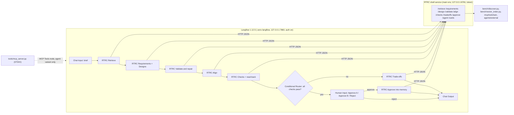

# Langflow shell for the RTRC pipeline: research and plan

Date: 2026-10-06. Status: proposal, not started. Scope: a drag-and-drop view of the project's flows for the advisor and RTRC: first the Part 2 agent flow (results page 2.1, §4–§11), then every page section (§12). Nothing here changes a score, the frozen task bank or the exam harness.

## 0. Summary

- Latest stable Langflow is **1.12.5** (released 2026-10-06), with the engine `lfx` 1.12.5; 1.13 exists only as development builds. The project's `.venv-langflow` was upgraded to both.
- Everything the plan needs exists in the official product: the Agent component, an OpenAI-compatible model provider, tools in Tool Mode, MCP as client and as server, Run Flow, Loop, the Knowledge component, the **Human Input** component and agent tool approval (human-in-the-loop since 1.11), custom Python components, and headless `lfx run` / `lfx serve`.
- **One implementation.** Every node calls the code that already produced the page's numbers (`bench/discover.py`, `bench/vector_index.py`, `mvp/toolchain`, `agents/external`). Langflow draws the flow, runs it, and pauses for the person; it does not reimplement any step.
- **Retrieval and memory stay ours.** Langflow's Knowledge component does plain similarity search with its own embedding models and Chroma store. Our retrieval (pinned MiniLM + FAISS, cosine ≥ 0.30 plus 0.10 per exact-name word, seeds plus one hop of neighbours, cards from the official parse) can only be identical if Langflow calls our code, in our pinned environment.
- **Claude Code / OpenCode** run through our existing bubblewrap sandbox, behind one custom node. Direct API calls use Langflow's OpenAI-compatible provider pointed at our Qwen endpoint.
- Effort: about **2.5–3 days** for the Part 2 flow, including parity tests and security set-up; about **5–5.5 days** for every page section as Langflow flows (§12), with a replay mode that shows the archived records without model calls.
- Correction to decision 003: it says Langflow has "no native approval gate". That was true before 1.11 and is no longer true; the other reasons stand.

## 1. What the official documentation says (checked 2026-10-06)

| Topic | Official pattern | Source |
|---|---|---|
| Versions | 1.12 (2026-09-01) finished moving integrations into separately installed "extension bundles" (`lfx-*` packages, `lfx-bundles`); 1.12.5 is the latest stable | [Langflow 1.12 release](https://www.langflow.org/blog/langflow-1-12/), [PyPI](https://pypi.org/project/langflow/) |
| Agents | The **Agent** component takes a Language Model, Agent Instructions, and tools on its Tools port; any component with Tool Mode on becomes a tool; a Structured Response output returns JSON. The **Simple Agent** template is the reference flow | [Use Langflow agents](https://docs.langflow.org/agents), [Quickstart](https://docs.langflow.org/get-started-quickstart) |
| Models | **OpenAI Compatible** provider: Base URL and API key in Settings → Model Providers (or `OPENAI_COMPATIBLE_BASE_URL` / `OPENAI_COMPATIBLE_API_KEY`); models are discovered from `/v1/models` and then selectable in any Language Model, Embedding Model or Agent field | [OpenAI Compatible](https://docs.langflow.org/bundles-openai-compatible) |
| Flows as tools | **Run Flow** runs another flow as a subprocess or as an agent tool. The target flow may not contain Human Input or approval-gated tools | [Run Flow](https://docs.langflow.org/run-flow), [Configure tools](https://docs.langflow.org/next/agents-tools) |
| Loops | **Loop** iterates over a list (Item → … → Looping, then Done). If-Else is not allowed inside a loop, so a conditional repair loop cannot be drawn with it | [Loop](https://docs.langflow.org/loop) |
| Retrieval (RAG) | **Vector Store RAG** template: a Load Data flow (Read File → Split Text → Embedding Model → vector store) and a Retriever flow (Chat Input → Embedding Model → vector store → Parser → Prompt → Language Model → Chat Output) | [Create a vector RAG chatbot](https://docs.langflow.org/chat-with-rag) |
| Knowledge bases | One **Knowledge** component with Ingest / Retrieve modes. Chroma local storage by default; only built-in embedding models; **only standard similarity search**; structured data only. For anything else the docs say to use vector-store and embedding components | [Knowledge Base](https://docs.langflow.org/knowledge-base), [Manage vector data](https://docs.langflow.org/knowledge) |
| Human-in-the-loop | **Human Input** pauses the run at a checkpoint, shows Form Content, and turns each User Action (e.g. Approve, Reject) into a branch; the run resumes without re-running finished steps; optional timeout with a Fallback branch. Alternatively an agent tool can be marked **Requires approval**. Over the API, a background run reports `suspended` and resumes with `POST /api/v2/workflows/{job_id}/resume` and an `action_id` (Workflow API, beta) | [Human-in-the-Loop](https://docs.langflow.org/human-in-the-loop), [Human Input](https://docs.langflow.org/human-input), [Workflow API](https://docs.langflow.org/workflow-api) |
| MCP client | **MCP Tools** connects a registered MCP server (STDIO command, or HTTP/SSE URL); in Tool Mode its toolset goes to an Agent's Tools port | [Use Langflow as an MCP client](https://docs.langflow.org/mcp-client), [MCP Tools](https://docs.langflow.org/mcp-tools) |
| MCP server | Every project is an MCP server whose flows are tools (`/api/v1/mcp/project/<id>/streamable`); Cursor, Claude Code and others connect to it | [Use Langflow as an MCP server](https://docs.langflow.org/mcp-server) |
| Custom components | Subclass `Component`, declare `inputs` / `outputs`, one method per output; `tool_mode=True` lets an agent call it. Load a folder with `LANGFLOW_COMPONENTS_PATH`, one sub-folder per category with an `__init__.py` | [Create custom Python components](https://docs.langflow.org/components-custom-components) |
| Headless | `lfx run flow.json "input"` runs a flow once to stdout; `lfx serve` exposes flows at `POST /flows/{id}/run`; `LANGFLOW_COMPONENT_CATEGORY_ALLOWLIST` / `_BLOCKLIST` restrict which component categories load | [Run flows with LFX](https://docs.langflow.org/lfx-run), [Serve flows with LFX](https://docs.langflow.org/1.11.0/lfx-serve) |
| Security | CVE-2025-3248 (unauthenticated code execution, fixed in 1.3.0, in CISA's exploited list) and CVE-2026-9103 (auto-login issued superuser tokens, fixed in 1.10.1). The docs ask for `LANGFLOW_AUTO_LOGIN=False`, a superuser password, a non-default secret key, and no exposed ports; in single-user mode every API key is a superuser key | [NVD CVE-2025-3248](https://nvd.nist.gov/vuln/detail/CVE-2025-3248), [IBM bulletin CVE-2026-9103](https://www.ibm.com/support/pages/node/7278926), [API keys and authentication](https://docs.langflow.org/api-keys-and-authentication) |

Coding agents outside Langflow: OpenCode has a headless server (`opencode serve`, HTTP API for sessions and prompts, optional basic auth) ([OpenCode server](https://opencode.ai/docs/server/)); third-party MCP bridges exist that let one agent drive OpenCode. None of these keep our sandbox, so the plan does not use them for anything scored.

## 2. What we already have

| Piece | Where |
|---|---|
| Part 2 flow, six stages | `bench/discover.py`: `retrieve_existing` (①), `write_requirements` + `write_design` (②), `_validate_design` with the ≤20 repair loop (③), `align` (④), `parsed_numbers` + `simulate` + `read_back` (⑤), `propose_tradeoffs`, `approval_block` + `approve` + `review_mapping` (⑥); `run(brief, progress)` runs them in order |
| Knowledge base ("memory") | MaritimeISR element cards built from its official parse (`bench/graph_query.py`), plus every approved design (`analysis/memory/approved.jsonl`, `analysis/memory/designs/`), plus alignment reviews (`analysis/memory/alignment-reviews.jsonl`) |
| Retrieval | `bench/vector_index.py`: pinned MiniLM snapshot and FAISS (`requirements-retrieval.txt`, `check()` self-test), cosine ≥ 0.30, +0.10 per exact-name word, seeds then one hop; Part 2 uses 4 seeds and up to 12 cards, the exam's P3 3 seeds and up to 6 cards from `analysis/vector-index/examples/` |
| Official validator | `mvp/toolchain` (Pilot 0.62), `mvp.engine.run_submitted_model` |
| MCP server | `tools/mcp_server.py` ("rtrc-tools"): `validate_sysml`, `check_budget`, run diff, `query_power`; refuses any path under `gold/` |
| Coding agents | `agents/external/jail.py` (bubblewrap sandbox, `./validate` in the scorer's file order), `agents/external/opencode_run.py`, `bench/run_claude_qwen.py`, `bench/run_agents_retry.py` |
| Direct model calls | `agents/llm.py` against the OpenAI-compatible Qwen endpoint in `.env` (`MVP_LLM_URL`, `MVP_LLM_API_KEY`) |
| Results page | `bench/exam_board.py` on 127.0.0.1:8770: 2.1 flow, 2.3 run record, approvals, model diagrams. It also serves answer keys, which is why it is stopped while agents run |

## 3. Design rules for the shell

1. **One implementation.** A Langflow node is a thin client; the step runs in our code. The only Langflow-native steps are labelled "native variant" on the canvas and in the run record.
2. **Our environment runs our code.** The retrieval stack is pinned and checked (decision 023). Langflow's venv has different packages (for example numpy 2.5.3 against our 2.2.6; no faiss, torch or sentence-transformers). So our steps run in a separate **shell service** in the main environment, and Langflow calls it over HTTP. No Langflow node imports `bench.*` directly.
3. **No answer keys anywhere.** The shell service exposes only gold-free operations (Part 2 never uses keys). The results page stays stopped while any agent runs, as now.
4. **The page stays the record.** Each run writes the same record as today (`analysis/discover-*.json`, memory files). Langflow's run history is a convenience, and the page's 2.3 shows the run.
5. **Secrets stay out of flows.** Keys live in environment variables and Langflow global variables; exported flow JSON is scanned before commit.

## 4. Architecture

## 5. Stage-by-stage mapping

| Our stage (page 2.1) | Official Langflow pattern | Node on the canvas | Backed by | Same as our pipeline? |
|---|---|---|---|---|
| Brief (2.2) | Chat Input / Text Input | Chat Input; optional **RTRC Brief from catalog** (part choices → brief) | `/catalog` → `brief_from` | Yes |
| ① Retrieve | Knowledge (Retrieve) or vector store + embedding nodes | **RTRC Retrieve** (outputs: cards as Message, full retrieval as JSON) | `/retrieve` → `retrieve_existing` | Yes, same code and pinned stack. The official Knowledge node would not be (§7) |
| ② Requirements and designs A / B | Prompt Template + Language Model, or Agent | **RTRC Requirements**, **RTRC Design** (variant A or B) | `/requirements`, `/design` → `write_requirements`, `write_design` | Yes, same prompts (rules + template + retrieved cards + brief). A native variant (Prompt Template + Language Model on Qwen) can sit beside it, labelled |
| Number source check | — | output of RTRC Requirements | same | Yes |
| ③ Official validation + repair (≤20) | tool call or Loop | **RTRC Validate and repair** | `/validate` → `_validate_design` | Yes. Loop cannot hold the conditional repair, so the loop stays inside the step |
| ④ Align with MaritimeISR | — | **RTRC Align** (mapping table, alignment package, Pilot result, diagram link) | `/align` → `align` | Yes. The per-pair Accept / Reject review stays on page 2.3 (one pause per pair would be unusable) |
| ⑤ Budget checks + read-back | — | **RTRC Checks** | `/checks` → `parsed_numbers`, `simulate`, `read_back` | Yes |
| Trade-offs | Conditional Router | Conditional Router on "all four checks pass" → **RTRC Trade-offs** | `/tradeoffs` → `propose_tradeoffs` | Yes |
| ⑥ Person decides | **Human Input** (User Actions → branches) | Human Input: Form Content = `approval_block` text; actions "Approve design A", "Approve design B", "Reject"; no fallback | then **RTRC Approve** → `/approve` → `approve` | Yes, the same memory write. Langflow pauses the run and resumes from its checkpoint |
| Output | Chat Output | summary + links to page 2.3 and `/api/diagram?run=…` | — | — |

## 6. Coding agents and direct API calls

**Claude Code / OpenCode (recommended path: our sandbox).** One custom node, **RTRC Sandboxed agent** (inputs: task text, agent = OpenCode or Claude Code, model, limits), calls `/agent`, which runs the existing runners inside `agents/external/jail.py`: a fresh workspace with the task input, AGENTS.md and `./validate`, no answer keys, the same time and validator limits as the retry run. It returns the answer, the official parse status, the run folder and the cost. In Part 2 it can replace "② Designs" as a variant ("design written by a sandboxed coding agent").

Not recommended for anything scored:
- `opencode serve` (OpenCode's own HTTP API). It runs outside our sandbox, so the agent could read the repository.
- Third-party MCP bridges that drive OpenCode from another agent. They are unvetted and outside the pinned stack.

**Reverse direction (optional).** Langflow's project MCP server can expose flows such as "retrieve from memory" or "validate a design" to Claude Code or OpenCode. It needs Langflow authentication, and it must not run while sealed exam tasks run, as with the results page.

**Direct API (Langflow-native).** Configure Settings → Model Providers → OpenAI Compatible with Base URL = our `MVP_LLM_URL` without `/chat/completions`, and the key from `MVP_LLM_API_KEY` through an environment variable. Then:
- the **native variant** of ② uses Prompt Template + Language Model (qwen3.8-flash or max), labelled;
- an optional **Langflow Agent** flow: an Agent on qwen3.8-max with Agent Instructions = AGENTS.md, plus an MCP Tools node connected over STDIO to `tools/mcp_server.py` (validate, budget check, query, diff); "approve into memory" is the only tool marked Requires approval. If wanted, this agent can later be scored as a new candidate by our harness (`lfx run` per task, the same scorer), which would need its own decision and cost estimate.

## 7. Knowledge base and retrieval

- **Authoritative:** the shell service builds the same library `_library()` builds today (MaritimeISR cards plus approved designs) and calls `bench.vector_index.retrieve`. At start it runs `vector_index.check()` and refuses to serve if a pin does not match.
- **Why not the official Knowledge component:** it would re-embed with Langflow's built-in models into Chroma and return plain top-k similarity. It cannot apply the 0.30 threshold, the exact-name bonus, the seed-then-one-hop expansion, the card caps, or the card text taken from the official parse. Results would differ from page 2.1/2.3 and from the exam's P3.
- **The memory is visible in Langflow (user's choice, option A, 2026-10-06):** `/cards` returns the library as rows (id, type, name, text, source, documentation). Flow F0 ingests them into a Langflow knowledge base `rtrc-memory` with the Knowledge component (Ingest mode), so RTRC browses the memory as Langflow's own knowledge base. The retrieval step still uses RTRC Retrieve, so results match the page; F0 re-ingests after each approval.
- **Reuse or new design, made visible:** ① already labels each run `reuse` (retrieved elements carry values; they become the design prompt's examples and the alignment target) or `new` (nothing related; no examples, so the design starts from scratch). In F4 a Conditional Router on that label draws the two cases as two branches into the same design step.
- **Parity test:** for 10 fixed briefs, the RTRC Retrieve node and a direct call to `retrieve_existing` must return byte-identical JSON (card ids, scores, roles, edges).

## 8. Human input in detail

- After ⑤, when all four checks pass for at least one design, the run reaches Human Input. Its Form Content is the same approval text the page shows (`approval_block`): requirements, numbers and their sources, the four checks, the read-back, the alignment summary, and links to the model diagrams.
- The User Actions "Approve design A", "Approve design B" and "Reject" become three branches. The approve branches call RTRC Approve, which writes memory exactly as the page's Approve button does. Reject ends with a Chat Output that records the reason.
- Langflow checkpoints the run, so approving later does not re-run ①–⑤. Programmatic approval uses the Workflow API (beta): a background run reports `suspended`, and `POST /api/v2/workflows/{job_id}/resume` with `{"action_id": "approve_design_a"}` resumes it.
- Per-pair alignment review stays on page 2.3. Run Flow cannot contain Human Input, and one pause per pair would be unusable.

## 9. Integrity and security checklist

- Langflow 1.12.5 and lfx 1.12.5, pinned in a new `requirements-langflow.txt`, installed only in `.venv-langflow`.
- Start through `scripts/langflow.sh`:
  - `LANGFLOW_AUTO_LOGIN=False`, a strong `LANGFLOW_SUPERUSER_PASSWORD` and `LANGFLOW_SECRET_KEY` from `.env` (gitignored);
  - bind to 127.0.0.1:7860;
  - `LANGFLOW_COMPONENTS_PATH=langflow/components`;
  - `LANGFLOW_COMPONENT_CATEGORY_BLOCKLIST` covering code-execution and file-system categories (prototypes, Python REPL, file system) so no flow can read the repository.
- The shell service binds 127.0.0.1:8781, requires a token header, and holds no answer keys. Its token and the Langflow API key are removed from the environment handed to sandboxed agents (the runners currently pass `os.environ` through, so this is a code change).
- While any agent run is in progress: the results page is stopped (as now), and Langflow either requires a key (auth on) or is stopped.
- Exported flows are scanned for keys before commit, with the same read-only secret scan as now.

## 10. Work plan

| Phase | Work | Files | Done when | Effort |
|---|---|---|---|---|
| 0 Set-up | Pin versions; secure start script; OpenAI-compatible provider for Qwen; register `tools/mcp_server.py` as a STDIO MCP server | `requirements-langflow.txt`, `scripts/langflow.sh`, `langflow/README.md` | Langflow starts with auth on; Simple Agent template answers through Qwen; MCP Tools lists `validate_sysml` | 0.5 day |
| 1 Service + nodes | Gold-free shell service over `bench/discover.py`; nine thin custom components | `bench/shell_service.py`, `langflow/components/rtrc/*.py` | each node runs alone in the Playground; service self-test (`vector_index.check()`) passes | 1 day |
| 2 Flow + person | Flow "RTRC Part 2 · six stages" with Conditional Router and Human Input; output links to page 2.3 and diagrams; export | `langflow/flows/rtrc-part2.json` | one brief runs end to end, pauses for approval, and the approval appears in page 2.3 and memory | 0.5 day |
| 3 Agents + variants | RTRC Sandboxed agent node; native ② variant; optional Langflow Agent flow with MCP tools and tool approval | `langflow/flows/rtrc-agent.json` | a sandboxed OpenCode / Claude Code design runs from the canvas with the same workspace and limits as the retry run | 0.5 day |
| 4 Parity + docs | Parity tests (retrieval byte-identical; prompts hash-identical; same SysML gives the same Pilot result); a page link "Open this flow in Langflow" in 2.1; decision record (new; amends 003); knowledge-base note | `bench/langflow_parity.py`, docs | parity tests pass; secret scan clean; decision written | 0.5 day |

Total about 3 days. Phases 0–2 alone (about 2 days) give the advisor/RTRC demo.

## 11. Risks and open questions

- **Churn.** Components moved into bundles between 1.10 and 1.12, and 1.13 is in development. Pin the versions and re-run the parity tests after any upgrade.
- **Workflow API is beta.** Resume semantics may change; the Playground path does not depend on it.
- **Repair loop and pair review stay inside steps** (Loop cannot branch; Run Flow cannot pause). The canvas shows them as single nodes.
- **Cost.** A canvas run costs the same as a page run (one Part 2 run is about 6–11 model calls). The optional Langflow Agent candidate on the 27 tasks would need its own budget.
- **Audience.** Worth doing only if the advisor or RTRC want a drag-and-drop canvas; the page already shows the same flow with real records.

## 12. The whole project in Langflow (all page sections)

Asked on 2026-10-06: show everything, not only Part 2. The user chose all of F0–F5 (F6 stays optional). The page has two agent flows doing real work, Part 2 (F4) and the MOD change chain (F5); F1–F2 show the exam's candidates, F0 the memory they read and write, F3 the results. One Langflow project, "RTRC SysML-AgentBench", with one flow per page section. Every flow runs in one of two modes, chosen on its first node:

- **Replay** (default): nodes read the archived record of a cell or run (the same files the page reads) and show each step's real input and output. No model call, no cost, and the numbers are the frozen ones.
- **Live**: nodes call the shell service and run the step again, with the same code as the page's console (1.5) and Part 2 (2.2). A live exam cell is written to a console results file, never to the scored batches.

| Flow | Page section | Node chain (all "RTRC" nodes are thin clients of the shell service) | Modes |
|---|---|---|---|
| F0 Memory and libraries | 0.2 | Model files (scenario, approved designs, official examples) → RTRC Official parse → RTRC Cards and edges → RTRC Vector index (self-test) → Chat Output (library sizes); optional Knowledge (Ingest) mirror | Replay; Live rebuild |
| F1 Exam: one cell, direct model | 1.1, 1.4, 1.5 | RTRC Cell picker (task, approach P0–P3, model, repeat) → RTRC Issue task (statement only) → RTRC Retrieve examples (P3 only) → RTRC Outline (P2/P3 only) → RTRC Write answer → RTRC Official syntax → RTRC Repair loop (P1–P3, ≤20) → RTRC Read values → RTRC Check against key → RTRC Approval gate → RTRC Archive → Chat Output (verdicts, link to page 1.4, diagram) | Replay any of the 648 direct cells; Live re-run |
| F2 Exam: one cell, sandboxed agent | 1.1 (agent path), 1.6 | RTRC Cell picker (task, OpenCode / Claude Code, model, repeat) → RTRC Issue task → RTRC Sandboxed agent (workspace, AGENTS.md, ./validate, limits) → RTRC Tool-call trace (Table) → RTRC Check against key → RTRC Archive → Chat Output | Replay any agent run (scored, superseded, retry); Live run in the sandbox |
| F3 Exam batch and results | 1.2, 1.3 | Replay: RTRC Facts → Tables (by type, approaches, agents, side benchmarks, costs, runs that do not count, retry). Live (optional): RTRC Cell list → Loop → Run Flow (F1 or F2) → RTRC Summarize | Replay; Live only by decision (costs) |
| F4 Part 2: blank task to approvable design | 2.1, 2.2, 2.3 | as in §4 and §5, with Human Input at ⑥ | Replay a saved run; Live |
| F5 MOD change chain | 2.4 | RTRC MOD picker → RTRC Baseline → RTRC Change model → RTRC Official syntax → RTRC Task and design verdicts → Human Input only if the change asks to relax a limit → Chat Output | Replay; Live |
| F6 Langflow-native agent (optional) | new | Chat Input → Agent (OpenAI-compatible Qwen, AGENTS.md as instructions) + MCP Tools (`tools/mcp_server.py`) → RTRC Check against key → Chat Output | Live |

How the canvas mirrors the page's diagrams:

- **Conditional steps skip themselves.** Langflow cannot merge two branches into one input, so the optional exam steps (Retrieve examples, Outline, Repair) are always on the canvas and report "skipped (P0)" when they do not apply, like the grey nodes in 1.1. Conditional Router is used only where the page has a real branch: trade-offs, and the approval gate in F4 and F5.
- **Nesting limits.** Run Flow cannot run a flow that contains Human Input, and Loop cannot contain If-Else. So F1 and F2 mark the approval gate as "flagged for a person" instead of pausing, F3's batch loop calls them through Run Flow, and the person decides after the loop. In the exam the gate never triggered.
- **Paper tags and owners.** Each node's name carries its stage label (① … ⑥, or the 1.1 step name). A canvas Note beside it says who does the step (Model, Code, Official tool, Person) and which paper it follows (Paper 1 align, Paper 2 retrieve, Paper 3 rules + repair), so the canvas reads like 0.3.
- **Answer keys stay out of Langflow.** RTRC Check against key returns the verdicts and the checklist items found or missing, not the key file. The side-by-side key view stays on the page (1.4). The replay endpoints are gold-free copies of the page's (the page's `/api/cell` includes the key text and is not used).

Node palette (category "RTRC", about 25 thin components): Cell picker, MOD picker, Brief; Issue task, Retrieve examples, Outline, Write answer, Sandboxed agent, Tool-call trace, Official syntax, Repair loop, Read values, Check against key, Approval gate, Archive; Retrieve memory, Requirements, Design, Validate and repair, Align, Checks and read-back, Trade-offs, Approve into memory; Official parse, Cards and edges, Vector index; Facts, Summarize, Diagram. Built-in nodes used: Chat Input / Output, Text Input, Conditional Router, Loop, Run Flow, Human Input, Note, Agent, Language Model, MCP Tools, Knowledge (mirror only).

Build order and effort for the whole project:

| Step | Flows | Effort |
|---|---|---|
| 1 | Set-up (§10 phase 0) and shell service with replay endpoints | 1 day |
| 2 | F4 Part 2 (replay + live + Human Input): demo-ready | 1 day |
| 3 | F1 exam one cell (replay first, then live) | 1 day |
| 4 | F2 agent cell and F5 MOD chain | 1 day |
| 5 | F3 results tables, F0 memory, notes and paper tags, parity tests, export, docs | 1–1.5 days |
| 6 (optional) | F3 live batch loop; F6 Langflow-native agent as a candidate | by decision |

About 5–5.5 days without step 6. After step 2 the advisor/RTRC demo works.

## 13. Correction to decision 003

Decision 003 (2026-10-02) gives three reasons. "A builder is not an evaluator" and "two implementations would fork the evidence" still hold, and this plan keeps a single implementation. "It has no native approval gate" no longer holds: since 1.11 Langflow has the Human Input component and agent tool approval, with checkpointed pause and resume.
